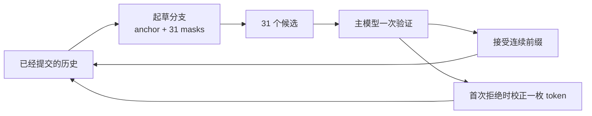
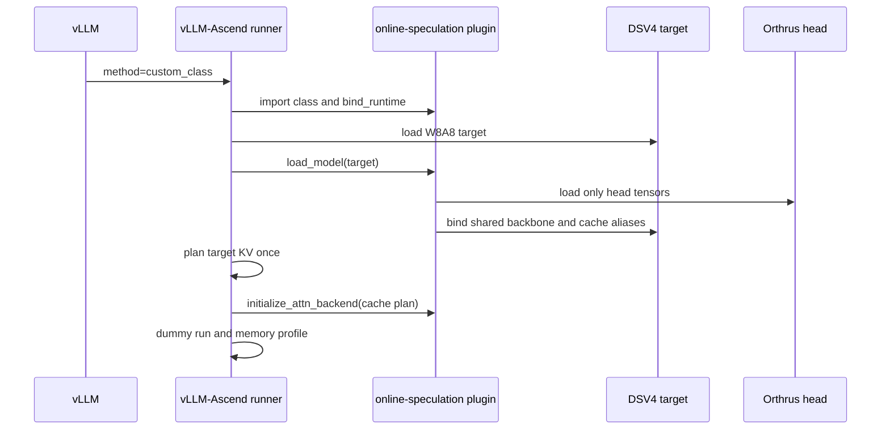

# DSV4-Flash online-speculation 当前设计说明

本文面向第一次接触大模型推理、投机解码、vLLM 和 Ascend 的读者。目标是循序渐进回答五个问题：

1. 常规大模型为什么生成得慢？
2. 常博的 `online-speculation` 算法究竟做了什么？
3. 为什么不能只写一个普通 vLLM 插件就运行？
4. 我们分别在 vLLM-Ascend 和 `online-speculation` 中增加了什么？
5. 当前已经做到哪一步，距离生产部署还缺什么？

本文记录的是 2026-09-21 的代码状态。当前目标模型固定为
`Eco-Tech/DeepSeek-V4-Flash-0731-w8a8`，运行环境固定为 Ascend A2 和
`quay.io/ascend/vllm-ascend:nightly-releases-v0.26.0rc`。

## 1. 先给结论

一句话概括当前设计：

> 主模型仍负责最终答案；一个只保存独立 attention 参数的轻量起草分支，一次猜 31 个 token；主模型一次验证整块并用严格的投机采样规则决定接受多少，因此算法正确时不会改变主模型的输出分布。

代码按职责分成三层：

| 仓库 | 放什么 | 当前是否需要修改 |
| --- | --- | --- |
| vLLM | 通用调度、验证和 rejection sampling | 不修改 |
| vLLM-Ascend | 把神经网络型 custom proposer 接入 NPU runner 生命周期 | 需要一小组通用改动 |
| `online-speculation` | 常博算法、DSV4 head、混合 KV 读取、训练、检查和部署脚本 | 作为独立插件维护 |

所以它不是“所有代码都塞进 vLLM-Ascend”，也不是“完全零改动的纯 Python 插件”。
算法和模型代码是插件；框架只补一个不含 Orthrus、常博或 DSV4 名字的通用接口。

当前代码已经完成了接口、模型、缓存和部署路径的实现与单元级验证，但还没有完成真实
DSV4-Flash 的 8 卡端到端正确性及性能验收，也还没有可用于生产收益验收的训练后 W8A8 head。
因此现在应称为“实现已接通，生产验收未完成”，不能称为“一键生产可用”。

## 2. 普通大模型为什么是一枚一枚生成 token

假设模型已经看到：

```text
北京是中国的
```

模型先计算下一个 token 的概率，选出“首”；得到“北京是中国的首”后，才能计算下一枚
token 是不是“都”。第二枚依赖第一枚，第三枚又依赖前两枚，所以生成过程天然串行：

```text
上下文 -> token 1 -> token 2 -> token 3 -> token 4
```

大模型的一次前向很贵，但每次通常只提交一枚 token。即使一张卡并行计算能力很强，
这条串行依赖链仍会限制单请求速度。

KV cache 解决的是“不要为旧文本重复计算 attention 的 K 和 V”，但没有消除“必须先知道
上一枚 token，才能生成下一枚”的依赖。

## 3. 投机解码怎样一次推进多枚 token

投机解码引入两个角色：

| 角色 | 作用 |
| --- | --- |
| proposer，也叫 drafter | 较便宜地猜一段候选 token |
| target，也叫 verifier | 用原始主模型一次检查整段候选 |

例如起草器一次猜出：

```text
首 / 都 / 北 / 京
```

主模型把候选整体放入一次因果前向中，可以同时得到这四个位置的正确分布。然后从左到右
验证：

```text
首  接受
都  接受
北  拒绝，改为主模型校正后得到的 token
京  本轮不提交
```

这一轮就提交了两个候选和一个校正 token，而不是只前进一步。若四个候选全部通过，
主模型还能从验证前向的最后一行再生成一枚 token。

### 3.1 为什么不必降低准确率

温度为 0 的贪心生成中，候选只有与主模型选择相同时才被接受，所以最终 token 可以与
target-only 逐 token 一致。

温度大于 0 时，候选来自起草分布 `q`，目标模型给出分布 `p`。标准 rejection sampling
按 `min(1, p(token) / q(token))` 接受候选；拒绝时从 `max(p-q, 0)` 的归一化残差中采样。
接受分支和残差分支相加后，最终分布仍然严格等于 `p`。

因此，投机解码的接受率影响速度，不应影响目标分布。真正可能造成结果错误的是工程实现
问题，例如候选概率与位置错位、随机数隔离错误、拒绝后缓存没有回滚，或起草阶段写坏了
主模型 KV。这正是我们需要大量缓存和采样测试的原因。

## 4. 常博算法与普通“小模型起草”有什么不同

最容易理解的投机解码是另放一个小模型，让小模型串行猜 token。常博的主线不是这样。
它源自 Orthrus 的“双注意力视图、共享骨干”设计，并增加了在线学习能力。

### 4.1 一套骨干，两套 attention

Transformer 每层可以粗略分为：

```text
attention + norm + MLP/MoE + 残差结构
```

当前设计保留两套 attention：

| 视图 | attention 参数 | 读取方式 | 用途 |
| --- | --- | --- | --- |
| AR target 视图 | 主模型原始 attention | 因果，只看过去 | 生成目标概率并验证 |
| diffusion draft 视图 | 单独训练的 attention head | 历史只读，当前块双向可见 | 并行猜一整块 |

两条视图共享 embedding、mHC（DSV4 的 hyper-connection 残差模块）、norm、MoE/MLP 和
LM head。也就是说，我们没有再复制一份
完整的 284B 主模型，只增加每层起草 attention 所需的参数。

这可以节省权重内存，但要注意：起草分支仍然需要经过所有 Transformer 层，并不是只有
一个很小的末端算子。它是否真正加速，最终取决于接受长度是否足以覆盖这次额外前向的成本。

### 4.2 K=32 的 anchor + mask 块

假设最后一枚已经提交的 token 叫 anchor。起草输入固定为 32 行：

```text
[anchor, MASK, MASK, ... , MASK]
   1 行          31 行
```

32 行在块内采用双向 attention，因此 MASK 位置之间可以交换信息。经过全部层后，前 31 行
各自产生一个候选分布，对应 31 枚待预测 token；最后一行参与块内计算，但不直接作为本轮
候选输出。



### 4.3 常博在 Orthrus 基础上增加了什么

常博的 `online-speculation` 不只是固定 head 推理，还包含：

- 把整块采样和校正张量化；
- 收集主模型验证时产生的真实反馈；
- 冻结共享骨干，只更新起草 attention；
- 保存 FP32 起草主权重并在请求边界发布；
- 用完整词表的分布差异训练，而不只监督最终标签；
- 支持从 AR attention 复制参数进行冷启动；
- 新 head 只有通过速度和质量门槛才投入服务。

当前 DSV4 服务实现的是其中的“固定 head 推理子集”。训练和异步续训有独立代码路径，
但尚未把 vLLM 在线请求中的 verifier 中间表示直接送入训练器，也不会在服务进程内热更新。

## 5. 为什么 DeepSeek-V4 Flash 适配更难

普通模型常常可以把历史想成每层一份规则的 KV cache。DSV4-Flash 的 43 层采用混合历史
结构，不同层可能属于 SWA、C4 或 C128。

| 类型 | 可以怎样理解 | 起草分支需要读取什么 |
| --- | --- | --- |
| SWA | 只保留最近一段原始历史 | target 的滑动窗口 KV |
| C4 | 每 4 个历史 token 压成一条，并用 learned indexer 选相关历史 | 压缩 KV、indexer key cache，以及 diffusion 自己的 query/indexer 投影 |
| C128 | 每 128 个历史 token 压成一条 | 所有已经完整形成的压缩 KV |

可以把它想成三个书架：近期原文书架、四页一册且带检索器的书架、128 页一册的长期书架。
起草 attention 必须根据当前层类型从正确书架读取，不能把三类缓存当成同一种普通 KV。

另外还有四个关键约束：

1. 历史缓存属于主模型，起草阶段只能读，不能写。
2. 当前 32-token 块需要自己的临时 K/V，并且块内双向可见。
3. C4 尚未凑满 4 个 token、C128 尚未凑满 128 个 token 的尾部仍是 compressor 状态，不能
   冒充一条完整压缩 KV。
4. 历史、当前块和 attention sink 分开计算时，不能直接平均输出，必须使用各段的
   log-sum-exp，也就是 LSE，按 softmax 分母精确合并。

若第四点处理错误，得到的不是“同一个 attention 被分段执行”，而是另一个数学函数，
接受率和输出都会变化。

## 6. 运行这套算法需要哪些东西

### 6.1 三份主要产物

| 产物 | 当前约定 |
| --- | --- |
| target | `Eco-Tech/DeepSeek-V4-Flash-0731-w8a8` |
| diffusion head | `orthrus-dsv4-head-v2`，生产时必须是独立校准的 W8A8 trained head |
| runtime | 固定 digest 的 vLLM-Ascend 0.26 镜像及匹配的 CANN、驱动和代码 commit |

head 只拥有各层 diffusion Q/KV/O 投影、norm、attention sink，以及 C4 diffusion-side
indexer 投影。它不拥有 embedding、mHC、MoE/MLP、LM head、target compressor 或历史 KV。

head manifest 还绑定 target 的 `config.json` 和权重索引 SHA256、43 层压缩布局、K=32、
mask token、tensor schema 和量化信息。换基模、换层布局或缺少 tensor 时会在分配 NPU 前
失败，而不是带着错误配置继续运行。

### 6.2 为什么 BF16 head 不能直接和 W8A8 target 混着部署

BF16 head 是训练交换格式。生产 target 是 W8A8，head 也需要针对自己的激活和权重单独
校准为 W8A8。直接复用 target 的量化 scale 只能制作验证加载链路的 initialized head，
不能代表训练 head 的数值范围，也不能通过生产 preflight。

当前仓库有 BF16 训练、导出、量化前后校验与封装脚本，但 stock ModelSlim 没有
Orthrus head-only 架构入口。仍需提供项目专用的 ModelSlim adapter，才能把真实训练 head
转换为合规的 Ascend W8A8 产物。

## 7. 现有框架为什么不能直接做到

### 7.1 上游 `custom_class` 已经提供了什么

上游 vLLM 能根据 Python 路径加载 custom proposer，并已有通用 scheduler、候选验证和
rejection sampling。这部分我们复用，不需要修改 vLLM core。

但是原始 `custom_class` 是 token-only 接口。它得到的主要是：

```text
刚采样的 token
每个请求的 token 数
token 历史
slot mapping
```

它适合 n-gram、检索或规则启发式 proposer。它并不会自动获得下面这些能力：

```text
加载一个 NPU draft model
加入 tensor parallel collective
参加模型显存 profiling
获得每层 attention metadata 和多组 block table
在 KV cache 规划前声明共享关系
绑定当前 worker 中已经加载的 target model
走 padded draft batch、拒绝回滚和 dummy-run 生命周期
```

所以“能 import 一个 custom class”不等于“能把共享骨干的神经网络 proposer 作为插件运行”。

### 7.2 vLLM-Ascend 已有 model proposer 为什么也不够

vLLM-Ascend 内建的 EAGLE、DFlash、DSpark 等 proposer 已经拥有上述 NPU 生命周期，但它们
由框架按已知 method 创建。普通 custom class 会走另一条轻量路径，不会进入模型加载、
attention backend 初始化和 cache planning。

直接把 Orthrus 伪装成 DSpark 也不正确。两者可以复用“并行块缓冲区、输入 padding、TP 和
验证调度”等基础设施，但：

- DSpark 有自己的半自回归生成语义；
- Orthrus 是 anchor + 31 masks 的双向块；
- DSpark 会维护可写 draft cache；
- Orthrus 必须只读 target 历史，并把当前块放在临时工作区；
- DSV4 Orthrus 还要按 SWA/C4/C128 读取多组 target cache。

因此我们只复用经过验证的运行骨架，不把 DSpark 当成算法本身，也不把它作为语义回退。

## 8. 我们增加了什么

### 8.1 vLLM core：零改动

继续使用上游的：

- `method="custom_class"` 配置和动态类加载；
- speculative scheduler；
- target block verification；
- 标准 rejection sampling；
- OpenAI API 服务层。

这样不会在 vLLM core 中增加一个长期维护的 `orthrus` method 或 DSV4 checkpoint 格式。

### 8.2 vLLM-Ascend：小而通用的 model-aware 扩展

第一步先补齐 NPU 上普通 `custom_class` 的 token-only 调用。这解决了“Ascend runner 会覆盖
上游已经创建的 custom proposer”和“请求 padding 后怎样只传真实请求”等问题，但仍不能
运行神经网络型 proposer。

第二步增加一个显式、带版本号的可选能力：

```python
class MyProposer:
    npu_model_runner_api_version = 1

    def bind_runtime(self, runtime):
        ...
```

只有声明这个 marker 的 proposer 才进入 model-aware 路径。`runtime` 提供当前
`VllmConfig`、NPU device 和现有 `NPUModelRunner`。随后插件复用内建 model proposer 的生命
周期，而不是自己复制一套 runner。

框架侧具体增加了：

| 接入点 | 为什么需要 |
| --- | --- |
| `bind_runtime(runtime)` | 让插件获得同一个 NPU runner、device 和分布式上下文 |
| `load_model(target_model)` | 加载 head，并在 target 已加载后绑定共享骨干 |
| `bind_shared_backbone(target)` hook | 复用 target 的 embedding、mHC、norm、MoE/MLP 和 LM head |
| 通用 `kv_sharing_target_layer_name` | cache planner 知道 draft 读取 target cache，不为历史再分配一份 |
| model proposer 输入路径 | 复用 padded batch、拒绝数量、位置和调度缓冲区 |
| `initialize_attn_backend` | 在 cache plan 完成后拿到每组 block table 和 metadata builder |
| `dummy_run` 和 profiling | 正确估算可用于 KV cache 的 NPU 内存 |
| `custom_proposer_config` | 给插件传 head 路径，同时由插件自行校验内部 schema |

这些接口不出现 Orthrus 或 DeepSeek-V4 名字。以后其他需要真实 NPU 模型、target 模块共享或
KV 别名的 custom proposer 也可以复用。

### 8.3 `online-speculation`：全部算法和 DSV4 专属实现

插件类 `OrthrusDSV4CustomProposer` 完成以下转换：

1. 对外仍表现为上游 `custom_class`。
2. 从 `additional_config.custom_proposer_config.orthrus.head_model` 读取 head 路径。
3. 在 NPU 分配前校验 v2 manifest。
4. 在内部创建 head 的 draft `ModelConfig`。
5. 绑定 vLLM-Ascend runtime 后，委托给 `AscendOrthrusProposer` 复用成熟的块起草基础设施。

`OrthrusDSV4DraftModel` 和每层 `_OrthrusAttentionLayer` 则实现真正的算法语义：

- 只加载 head-owned tensor；
- 用弱引用绑定 live target，避免复制共享骨干；
- 为 SWA/C4/C128 cache 注册 target 别名；
- 删除不属于 head 的 target compressor 模块；
- 为 32 行块计算 diffusion query 和临时 local KV；
- C4 使用 diffusion-side indexer 查询 target indexer key cache；
- 分别计算历史段、local block 和 attention sink；
- 用 LSE 精确合并各段；
- 调用 target 的 mHC、norm、MoE/MLP 和 LM head；
- 可用 checksum 检查起草前后 target cache 完全不变。

### 8.4 启动时发生什么



### 8.5 每轮解码发生什么

```text
1. scheduler 取出本轮请求和已经提交的历史
2. proposer 构造每请求 32 行的 anchor + mask 块
3. head 逐层读取 target 的 SWA/C4/C128 历史
4. 当前块在临时工作区做双向 attention，不写 target KV
5. 共享骨干继续前向，得到 31 个候选分布并采样候选
6. target 一次验证候选块
7. vLLM 标准 rejection sampling 接受连续前缀或生成校正 token
8. 只提交真实接受的 token；下一轮从新的已提交历史继续
```

## 9. 为什么这个边界比“大 patch”或“纯插件”更合适

把所有代码直接写进 vLLM-Ascend 的问题是：框架要长期维护 DSV4 Orthrus 的 head schema、
K=32、训练产物和混合 cache 语义，模型演进会不断扩大改动面。

完全不改 vLLM-Ascend 的问题是：插件只能拿到 token 级回调。它若自己重建 runner、TP、
cache planner 和 attention metadata，不但代码重复，而且极容易产生两个互不一致的缓存所有者。

当前边界把二者拆开：

```text
vLLM-Ascend = 提供“神经网络 custom proposer 怎样接入 NPU runner”的通用插座
online-speculation = 插在插座上的 DSV4 Orthrus 设备
```

在通用接口尚未进入目标镜像前，有两条部署路径：

| 路径 | 用途 |
| --- | --- |
| model-aware custom proposer 分支 | 最终推荐路径，框架改动通用且算法保持插件化 |
| v0.26 guarded runtime overlay | 固定内网镜像的过渡方案，可校验版本并打受控 patch |

当前 model-aware feature 分支基于较新的 vLLM-Ascend main，用来整理和提交通用接口；它不能
直接替换 v0.26 镜像中的源码。指定的内网 v0.26 镜像应使用同仓库中版本锁定、可 dry-run 的
runtime overlay，或者把同一组通用接口有针对性地 backport 到 v0.26 release 分支。

因此目前仍需要使用带这组通用改动的 vLLM-Ascend 分支，或者对固定镜像应用受控 patch。
仅安装 `online-speculation` Python 包还不够。将来若通用 model-aware 生命周期被框架正式
接收，算法侧无需再随镜像打 patch。

## 10. 当前完成度

### 10.1 已经完成

| 项目 | 状态 |
| --- | --- |
| vLLM core 改动 | 无需修改 |
| Ascend token-only `custom_class` | 已实现并测试 |
| model-aware proposer API v1 | 已实现并测试 |
| 插件与 head 路径分离 | 已实现 |
| K=32 anchor + mask proposer | 已实现 |
| 共享 target backbone | 已实现 |
| SWA/C4/C128 target history 读取 | 已实现 |
| C4 diffusion-side indexer | 已实现 |
| 分段 attention 的 LSE 精确合并 | 已实现并有数学测试 |
| target cache 只读校验 | 已实现 checksum 调试路径 |
| v2 head 契约和严格 preflight | 已实现 |
| BF16 head 训练、恢复、异步续训入口 | 已实现，微型模型已验证反向和冻结边界 |
| target-only、Orthrus、回滚和 benchmark 脚本 | 已实现 |
| 配置解析与启动 dry-run | 已验证 |

现有回归记录中，算法插件测试为 213 passed、26 skipped；新增 custom proposer 适配测试为
4 passed；vLLM-Ascend 相关聚焦测试为 9 passed，并通过对应静态检查。这里的 `skipped`
主要是当前机器缺少特定运行环境的测试，不代表 8 卡生产验收已经完成。

### 10.2 还没有完成

| 项目 | 为什么仍是阻塞项 |
| --- | --- |
| 真实 DSV4-Flash 8 卡 API 完整启动 | 最近一次尝试期间远端主机失联并重启，未得到首个真实 completion；实验容器已清理，8 卡保持空闲 |
| 真实训练后的 head | initialized head 只能证明加载链路，不能代表接受率或收益 |
| head-only ModelSlim adapter | stock ModelSlim 没有该架构入口，仓库目前只定义调用和校验边界 |
| greedy 逐 token 等价 | 必须在真实 target/head/runtime 上跑完整服务对照 |
| 并发概率采样正确性 | 需验证每请求 RNG 隔离、分布和连续拒绝 |
| 分页边界与长上下文 | 需覆盖 127/128/129、32K、128K，最终再验证 1M |
| graph 路径 | 当前以 eager 为正确性基准，尚未通过 graph 矩阵 |
| 生产性能收益 | 没有 trained head 的真实接受率和 paired goodput，不能声称优于 target-only 或社区 PR |
| 服务内在线更新 | 当前是异步 sidecar 训练、校准、重启发布，不是 vLLM 进程内热更新 |
| DSA CP 和 FlashComm1 | 当前明确关闭，需单独适配其 query 布局、collective 和输出投影路径 |

### 10.3 为什么现在还不能说“一键生产部署”

一键脚本已经存在，但脚本只能自动执行我们已经定义的步骤，不能替代缺失的模型产物和验收。
当前至少缺少：

1. 外部团队交付的、与该 target 哈希匹配的 trained BF16 head；
2. 独立校准该 head 的 ModelSlim adapter 和生产 W8A8 head；
3. 一次不被中断的 8 卡 eager 端到端正确性矩阵；
4. 使用真实业务分布的接受长度和 goodput 对照。

所以现在的脚本可作为 bring-up 自动化，不应绕过 `--require-trained` 和正确性门槛直接作为
生产发布工具。

## 11. 下一次 8 卡验证应该怎样进行

按下面顺序做，每一步失败都先停止，不直接跳到性能压测：

1. 预约独占 8 卡窗口，确认没有其他容器占卡。
2. 固定镜像 digest、vLLM/vLLM-Ascend commit、CANN 和驱动。
3. 使用 `MODEL_LOAD_THREADS=8` 或 `16` 做共享机器 bring-up，避免 8 个 TP worker 各自用
   128 线程同时读取权重导致 CPU 和存储被打满。
4. 先启动 target-only，并得到 OpenAI API completion。
5. 使用 initialized head 启动 Orthrus eager，只验证模型加载、共享和请求闭环。
6. 打开 cache checksum，覆盖单请求、并发、连续拒绝和分页边界。
7. 对 target-only 与 Orthrus 做 greedy token equality。
8. 换入 independently calibrated trained W8A8 head，验证固定种子和分布正确性。
9. 用真实或代表性流量测 TTFT、TPOT、throughput、goodput、平均接受长度、拒绝率、
   draft/verify 耗时和 NPU 内存。
10. 只有所有正确性切片通过且 goodput 至少提高 5%，才默认启用 Orthrus；否则保留
    target-only 回滚路径。

## 12. 常见问题

### 12.1 这是训练推理一体吗？

不是同一个延迟敏感进程。推理服务加载固定 W8A8 head；BF16 sidecar 可以离线训练或使用
新完成请求做异步续训。新 head 经过评测、独立量化和 preflight 后，通过重启服务替换。

### 12.2 未来别人给一个训练好的 head，能直接替换吗？

只有它满足 v2 contract、绑定完全相同的 target 哈希和压缩布局，并经过独立 W8A8 校准时
才可以。替换目录后重启服务，不支持进程内热替换。

### 12.3 换一个模型还能直接使用吗？

model-aware custom proposer 接口可以复用，但 head 和 DSV4 混合 cache 实现不能原样复用。
每个基模都需要匹配的训练 head；若模型 attention/KV 结构不同，还需要新的算法插件适配，
不需要重新发明整个 vLLM-Ascend 生命周期。

### 12.4 少于 8 张卡能验证吗？

可以验证 schema、数学、head 构造、混合 cache、TP shard 和训练反向；不能证明完整 284B
DSV4-Flash W8A8 能加载、服务正确或有生产收益。正式端到端验收仍需要 8 x 64 GiB A2。

### 12.5 当前设计会复制第二份主模型或第二份历史 KV 吗？

设计目标是不复制。draft 只加载 attention head，通过 live target 引用复用共享层，并通过
cache alias 读取 target 历史。dummy-run 和最终 NPU 内存数据仍要在真实 8 卡启动中确认
没有框架侧意外重复分配。

### 12.6 我们现在比社区 Orthrus PR 更好吗？

目前不能这样声称。我们的设计覆盖了 DSV4 特有的 SWA/C4/C128 历史、C4 indexer、严格
head 契约和 Ascend 部署边界，这是适配范围上的区别；但在完成相同硬件和工作负载下的
正确性、接受率及 goodput 对照前，没有性能优越性的证据。

## 13. 代码入口

`online-speculation`：

- `src/blockspec/vllm_ascend/dsv4_custom_proposer.py`：公开 `custom_class` 入口。
- `src/blockspec/vllm_ascend/dsv4_proposer.py`：K=32 块起草与 Ascend runner 适配。
- `src/blockspec/vllm_ascend/dsv4.py`：共享骨干和 SWA/C4/C128 attention 实现。
- `src/blockspec/vllm_ascend/dsv4_hybrid.py`：分页历史读取和 LSE 精确合并。
- `src/blockspec/vllm_ascend/head_contract.py`：v2 head 契约。
- `src/blockspec/dsv4_training.py`：BF16 head 训练实现。
- `scripts/serve_dsv4_orthrus_plugin.sh`：插件式服务入口。
- `scripts/deploy_dsv4_offline.sh`：固定内网环境的一键 bring-up。

vLLM-Ascend：

- `vllm_ascend/spec_decode/custom_class.py`：model-aware API v1。
- `vllm_ascend/spec_decode/llm_base_proposer.py`：共享 target backbone hook。
- `vllm_ascend/worker/model_runner_v1.py`：加载、输入、profiling、cache planning 生命周期。
- `vllm_ascend/ascend_config.py`：插件私有配置命名空间。

相关提交：

- [vLLM-Ascend: NPU token-only custom class](https://github.com/wangzili121/vllm-ascend/commit/a09abd67d998418df9283a546c2d1733ffd54363)
- [vLLM-Ascend: model-aware custom proposer](https://github.com/wangzili121/vllm-ascend/commit/f5d7f4b18e566d28777ad0be7ea01a90403c5732)
- [`online-speculation`: DSV4 Orthrus plugin path](https://github.com/wangzili121/online-speculation/commit/bd90a7cf44e83830443b4d838d746dba62df02c3)

更深入的算法推导见 [ALGORITHM.md](ALGORITHM.md)，head 格式见
[DSV4_HEAD_CONTRACT.md](DSV4_HEAD_CONTRACT.md)，具体部署命令见
[DSV4_DEPLOYMENT.md](DSV4_DEPLOYMENT.md)。
