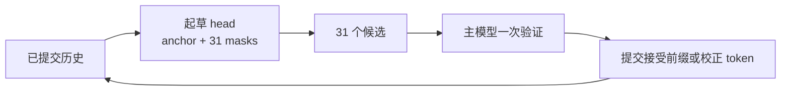

# DSV4-Flash online-speculation 当前设计

> **当前定位：代码接入基本完成，生产验收尚未完成。**

我们的目标是在 Ascend A2 上，把常博的 `online-speculation` 接入
`Eco-Tech/DeepSeek-V4-Flash-0731-w8a8`，最终通过 vLLM OpenAI API 提供服务。

## 1. 算法在做什么

普通大模型一次生成一枚 token，因为后一枚依赖前一枚，整个过程是串行的：

```text
上下文 -> token 1 -> token 2 -> token 3
```

投机解码增加一个 proposer，先猜一段候选，再由主模型一次验证整段。常博的方法不是再放
一个完整小模型，而是在主模型旁增加一套独立训练的 attention head：

- 共享主模型的 embedding、mHC、norm、MoE/MLP、LM head 和历史 KV；
- 每轮输入 `1 个 anchor + 31 个 mask`，一次猜 31 枚 token；
- 主模型一次验证候选，只提交通过的连续前缀；
- 首次拒绝时使用标准 rejection sampling 生成校正 token。



正确实现时，投机解码不会改变主模型的输出分布。接受率决定能否加速，而不是决定答案
是否正确。工程上仍需验证位置对齐、随机数隔离、拒绝回滚和 KV 不被污染。

常博完整算法还支持根据 verifier 反馈继续训练起草 attention。当前 DSV4 服务先实现
**固定 head 推理**；训练和异步续训在独立进程中完成，新 head 校验、量化后通过重启替换。

## 2. 为什么 DSV4 适配困难

DSV4-Flash 的 43 层不是统一的普通 KV cache，而是混合使用三种历史：

| 类型 | 含义 | 起草 head 需要读取 |
| --- | --- | --- |
| SWA | 最近一段原始历史 | 滑动窗口 KV |
| C4 | 每 4 个 token 压成一条 | 压缩 KV、indexer key cache 和检索结果 |
| C128 | 每 128 个 token 压成一条 | 完整的长期压缩 KV |

因此，起草 head 必须做到：

1. 根据层类型读取正确的 target cache；
2. 当前 32-token 块使用临时双向 attention；
3. 历史 cache 只读，不能被 draft 写坏；
4. 历史、当前块和 attention sink 分开计算后，使用 LSE 精确合并。

这也是为什么不能把 Orthrus 简单伪装成 DSpark。两者可以复用 NPU 缓冲区、TP 和调度
基础设施，但生成语义和 cache 所有权不同。

## 3. 为什么普通 `custom_class` 不够

上游 vLLM 已经支持 `custom_class`，但原始接口主要是：

```text
输入 token 历史 -> 返回候选 token
```

它适合 n-gram、检索或规则 proposer。常博的 proposer 是一个真实的 NPU 神经网络，还需要：

- 加载和切分 head 权重；
- 参与 tensor parallel；
- 获得 attention metadata 和多组 block table；
- 在 cache planning 前声明共享关系；
- 绑定已经加载的 target model；
- 参与显存 profiling、dummy run、padding 和拒绝回滚。

所以“可以 import custom class”不等于“可以运行共享骨干的神经网络 proposer”。

## 4. 当前设计

| 仓库 | 职责 | 改动形式 |
| --- | --- | --- |
| vLLM | 调度、候选验证、rejection sampling、OpenAI API | 不修改 |
| vLLM-Ascend | 提供通用 model-aware custom proposer 生命周期 | 小型通用接口 |
| `online-speculation` | 常博算法、DSV4 head、混合 KV、训练和部署 | 独立插件 |

### vLLM-Ascend 增加什么

插件声明：

```python
class MyProposer:
    npu_model_runner_api_version = 1

    def bind_runtime(self, runtime):
        ...
```

框架随后让它进入已有 model proposer 生命周期，包括：

- `bind_runtime`：获得当前 NPU runner、device 和配置；
- `load_model`：加载 head 并绑定 target；
- `bind_shared_backbone`：复用 target 的骨干模块；
- `kv_sharing_target_layer_name`：让 cache planner 不重复分配历史 KV；
- `initialize_attn_backend`、`dummy_run`：接入 cache plan 和显存 profiling。

这些接口不包含 Orthrus 或 DSV4 名字，其他神经网络 proposer 也可以复用。

### `online-speculation` 插件增加什么

- `OrthrusDSV4CustomProposer`：公开的 `custom_class` 入口；
- `AscendOrthrusProposer`：K=32 起草、输入准备和拒绝处理；
- `OrthrusDSV4DraftModel`：只加载独立 attention head，绑定 live target；
- SWA/C4/C128 读取、C4 diffusion-side indexer 和 LSE 精确合并；
- target cache checksum、head v2 契约和严格 preflight；
- BF16 训练、恢复、异步续训、量化封装及部署脚本。

启动关系可以概括为：

```text
vLLM 创建 custom_class
        ↓
vLLM-Ascend 传入 NPU runtime
        ↓
插件加载 head 并绑定 target
        ↓
cache planner 只分配一份 target 历史
        ↓
进入正常 propose -> verify -> accept 循环
```

## 5. 为什么仍需要一个小 patch

算法代码已经是独立插件，但当前 vLLM-Ascend 还没有正式提供 model-aware 生命周期。
完全不改框架时，插件只能拿到 token 级回调；若插件自己复制 runner、TP 和 cache planner，
会产生重复代码和不安全的双重 cache 所有权。

因此当前方案是：

> 算法保持插件化，vLLM-Ascend 只补一个通用“神经网络 proposer 插座”。

当前通用 feature 分支基于较新的 vLLM-Ascend main，不能直接覆盖指定的 v0.26 镜像。
内网 v0.26 镜像应使用仓库中的版本锁定 runtime overlay，或把相同接口定向 backport 到
v0.26 release 分支。未来若通用接口进入框架，算法插件本身不再需要随镜像打 patch。

## 6. 当前完成度

### 已完成

| 项目 | 状态 |
| --- | --- |
| NPU `custom_class` 和 model-aware API | 已实现并测试 |
| K=32 起草和共享 target backbone | 已实现 |
| SWA/C4/C128 历史读取 | 已实现 |
| C4 indexer 和 LSE 精确合并 | 已实现并有数学测试 |
| cache 只读检查 | 已实现 |
| head v2 契约和 preflight | 已实现 |
| BF16 head 训练、恢复和续训入口 | 已实现，小模型反向已验证 |
| 服务、回滚和 benchmark 脚本 | 已实现 |

### 尚未完成

| 项目 | 当前阻塞 |
| --- | --- |
| 真实 DSV4 8 卡 API 闭环 | 最近一次启动期间主机失联并重启，未得到首个真实 completion |
| 生产 trained head | initialized head 只能验证加载链路，不能验证接受率 |
| head-only ModelSlim adapter | stock ModelSlim 没有该架构入口 |
| 完整正确性矩阵 | 仍需验证并发采样、连续拒绝、分页边界和长上下文 |
| 性能结论 | 没有 trained head 的 paired goodput，不能宣称优于 target-only 或社区 PR |
| graph、DSA CP、FlashComm1 | 当前以 TP-only eager 作为正确性基准 |

因此当前最准确的表述是：

> **核心代码已经接通并完成单元级验证，但真实 8 卡正确性和性能验收尚未完成。**

## 7. 下一步

1. 在独占 8 卡窗口先启动 target-only，确认 DSV4 OpenAI API 正常。
2. 使用 initialized head 启动 Orthrus eager，完成加载和请求闭环。
3. 验证 greedy token 一致、cache 不变、并发拒绝和分页边界。
4. 接收 trained BF16 head，通过专用 ModelSlim adapter 校准成 W8A8。
5. 在真实业务分布上测接受长度和 goodput；提升至少 5% 才默认启用。

target-only 启动脚本始终保留为回滚路径。当前 8 张实验卡已经释放，不会自动恢复任务。

## 8. 相关文档

- [算法完整推导](ALGORITHM.md)
- [插件与框架边界](CUSTOM_PROPOSER_INTEGRATION.md)
- [DSV4 head v2 契约](DSV4_HEAD_CONTRACT.md)
- [DSV4 部署和验收](DSV4_DEPLOYMENT.md)
- [DSV4 训练与续训](DSV4_TRAINING.md)

相关代码分支：

- [online-speculation 插件分支](https://github.com/wangzili121/online-speculation/tree/feature/model-aware-custom-proposer)
- [vLLM-Ascend 通用接口分支](https://github.com/wangzili121/vllm-ascend/tree/feature/model-aware-custom-proposer)
