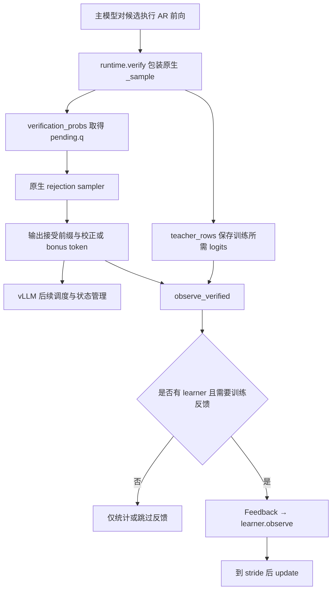

# Qwen3.8 Orthrus 代码阅读指南

这是 vLLM-Ascend 版的独立中文学习分支。你可以从本文进入代码：核心源码在函数旁解释职责，在计算、状态变化、边界检查和反向传播处补充中文说明。原有英文文档字符串也保留，便于对照。换行后的参数列表属于同一条语句，一起阅读。

本分支基于 `feature/orthrus-qwen38` 的 `d9a0193`，不是 PyPTO 开发分支。修改仅为注释和文档，不包含另一对话中尚在进行的代码开发。阅读时以这里固定的代码为准，避免把后来的实验结果当成当前实现。

## 先掌握数据与参数的区别

下列符号在代码注释中反复出现：

| 名称 | 形状或含义 | 在哪里产生、交给谁 |
| --- | --- | --- |
| `tokens` / `inputs` | 整数 token ID，通常 `[1,K]` | tokenizer 或 proposer 构造，交给 embedding |
| `hidden` | 浮点特征，通常 `[1,K,H]` | embedding 和各层产生，交给下一层 |
| `logits` | 词表分数，通常 `[1,K,V]` | LM head 产生，交给采样器或 loss |
| `history` | 每层 AR 历史：KV 或 GDN 状态 | 原生 cache 读取器产生，供 draft 读取 |
| `q` | 实际起草概率，通常 `[K−1,V]` | draft 采样策略产生，交给原生 rejection sampler；greedy 可为 `None` |
| `pending` | 一轮起草的输入、历史、候选、q、boundary | proposer 保存，验证反馈到达后消费 |
| `boundary` | 待训练后缀入口的 hidden、位置、mask 等 | draft 前向捕获，供训练重新计算后缀 |
| `master` | 选中 draft 参数的 FP32 副本 | learner 创建，AdamW 更新后复制回执行参数 |

`K` 是块长，包含 anchor；配置 K32 时最多预测 31 个候选。`H` 是隐藏维度，`V` 是词表大小。`anchor` 在起草函数中是 token ID，在离线数据抽样中是序列位置索引，需要结合函数区分。

**张量不是参数。** `hidden`、`logits` 随输入变化；权重矩阵是模型参数。两个模块共享参数，不代表它们共享不同输入下的计算结果。

## 目录怎样分工

```text
online-speculation/
├── scripts/                    进程入口：服务、训练、数据准备、实验
├── src/blockspec/
│   ├── vllm_ascend/             与原生 vLLM worker、权重、缓存和 NPU 算子对接
│   ├── parallel/               模型结构、采样包装、训练重放、数据读取
│   ├── feedback.py             训练反馈数据结构
│   ├── sampling.py             概率处理与独立校正参考
│   └── …                      其他模型/通用研究工具
├── tests/                      数学、模块、适配契约等自动化测试
└── docs/                       设计、运行说明及原始实验记录
```

`parallel/` 是历史目录名，不代表其中所有东西都是分布式实现。Qwen 的 TP 权重与通信适配主要在 `vllm_ascend/qwen38_weights.py`。

### 按下面顺序打开核心文件

| 顺序 | 文件 | 负责什么；不负责什么 |
| --- | --- | --- |
| 1 | [run_qwen38_vllm.py](../scripts/run_qwen38_vllm.py) | 拼接服务配置并执行 `vllm serve`；不计算 Attention |
| 2 | [qwen38_proposer.py](../src/blockspec/vllm_ascend/qwen38_proposer.py) | 组织模型装配、起草、候选概率、验证反馈与 head 导入导出；不是 scheduler |
| 3 | [qwen38.py](../src/blockspec/parallel/qwen38.py) | 定义双视图、混合 block、临时 cache 和后缀 forward；不处理 HTTP |
| 4 | [qwen38_history.py](../src/blockspec/vllm_ascend/qwen38_history.py) | 从原生 cache 选出已提交前缀；不是重新跑主模型历史 |
| 5 | [qwen38_weights.py](../src/blockspec/vllm_ascend/qwen38_weights.py) | 共享原生参数、拆 TP 分片、定义通信反向及 native learner；不再加载完整 checkpoint |
| 6 | [qwen38_ops.py](../src/blockspec/vllm_ascend/qwen38_ops.py) | 装配已有 NPU 算子或可微路径，执行 draft 的具体计算；没有自研 kernel |
| 7 | [qwen38_runtime.py](../src/blockspec/vllm_ascend/qwen38_runtime.py) | 把起草、历史 metadata 和验证回调接进限定版本 runner；保留原生 sampler |
| 8 | [online.py](../src/blockspec/parallel/online.py) | 选择 last-N 参数，重放、计算梯度、优化和发布；离线也复用它 |
| 9 | [feedback.py](../src/blockspec/feedback.py) | 把输入、历史、教师分数和 boundary 打包、detach |
| 10 | [train_qwen38_draft.py](../scripts/train_qwen38_draft.py) | 读取语料、抽 anchor、调用离线 worker RPC 并保存结果 |
| 11 | [qwen38_training.py](../src/blockspec/parallel/qwen38_training.py) | 构造离线教师监督与 MASK 输入；不管理优化器 |
| 12 | [fitting.py](../src/blockspec/parallel/fitting.py) | 此路径复用 `TokenDataset`、`BatchStream`；里面的独立 `Trainer` 不属于 native RPC 主链 |
| 13 | [prepare_qwen38_data.py](../scripts/prepare_qwen38_data.py) | 本地文本/对话/Parquet 编码成 tokenized JSONL |

以下文件先知道用途，之后遇到具体调用再看：

| 文件 | 用途 |
| --- | --- |
| [qwen38_attention.py](../src/blockspec/vllm_ascend/qwen38_attention.py) | **主模型 verifier** 的分页 FIA query 切片，保持 K32 的因果语义；不是 draft 双向 mask |
| [qwen38_gdn_backend.py](../src/blockspec/vllm_ascend/qwen38_gdn_backend.py) | 原生 GDN 递推切片与可选 CANN prefill 适配 |
| [qwen38_loss.py](../src/blockspec/vllm_ascend/qwen38_loss.py) | 可选词表分片 KL/TV，避免学生完整词表 logits gather |
| [parallel/sampling.py](../src/blockspec/parallel/sampling.py) | `ProposalSampler` 封装候选生成；服务验证不调用它的参考 `verify()` |
| [sampling.py](../src/blockspec/sampling.py) | 温度、top-k/top-p、概率抽样和独立校正数学参考 |
| [parallel/backbone.py](../src/blockspec/parallel/backbone.py) | Qwen 复用 `BackboneOutput` / `DraftBoundary`；同文件普通 Transformer 实现不是 Qwen GDN 模型 |
| [parallel/branches.py](../src/blockspec/parallel/branches.py) | 独立参考生成器的 branch 抽象；不要与 vLLM 原生缓存提交路径混用 |
| [plugin.py](../src/blockspec/vllm_ascend/plugin.py) | 注册通用/DSV4 模型类；Qwen proposer 主要通过 `custom_class` 完整 Python 路径接入 |

全部已注释函数的入口、参数和静态调用线索见 [函数索引](QWEN38_FUNCTION_INDEX.md)。其他脚本的逐文件分工见 [文件索引](QWEN38_FILE_INDEX.md)。

## 第一次启动时发生什么

```text
run_qwen38_vllm.main()
  ├─ arguments()：读取 --tp / --online / --last-layers 等
  ├─ native_options()：原生模型、worker 扩展、eager、KV 配置
  └─ speculative_options()：custom_class 路径、候选数、head/更新选项
       ↓ vLLM 创建 worker 和 proposer，加载原生主模型
Qwen38OrthrusProposer
  ├─ __init__()：检查配置、装配 runner/Attention/GDN hooks
  ├─ bind_runner()：绑定 runner 与 TP 通信组
  └─ load_model(target_model)
       ├─ from_native_model() → Qwen38DualView
       ├─ NativeHybridHistory(...)：建立原生历史读取器
       ├─ _load_head()：配置 head_dir 时加载 head
       └─ NativeSuffixLearner(...)：启用更新时创建训练器
```

这里的调用顺序经过 vLLM 自身生命周期分发，不是 `main()` 直接逐个调用 worker 方法。`custom_class` 只是让框架知道构造哪个 proposer；`runtime` hooks 才补上原生模型绑定、历史传递和验证反馈。

`from_native_model()` 在 `meta` 设备建模型骨架，再把原生 TP 参数映射进去。meta 只有形状，不分配真实大矩阵；映射结束必须确认没有漏掉的 meta 参数。随后 `_HybridLayer.__init__()` 独立复制 mixer 参数形成 draft，norm/MLP/embedding/head 继续共享。

## 一轮推理：沿数据读代码

以 K32 为例，假设主模型已生成一个新 token。它是下一轮 draft 的 anchor；它之前的 token 对应严格 AR 历史。

```text
NPUModelRunner.propose_draft_token_ids()
  → runtime 中的 draft() 包装
  → proposer.propose_batch()
      ├─ _clear_request()：新请求才清理旧状态
      ├─ history_reader.read() → HybridHistory
      ├─ inputs = [anchor, MASK, …, MASK]，形状 [1,32]
      ├─ model(inputs, view="draft", cache=history, capture_layer=...)
      │    → Qwen38DualView.forward()
      │       → _block_inputs()：embedding、位置、mask
      │       → _HybridLayer.forward()，逐层执行
      │       → _logits()：最终 norm 和 LM head
      ├─ logits[0, :-1]，形状 [31,V]
      ├─ ProposalSampler.propose() → candidates、q
      └─ 保存 pending，返回候选 ID 给 vLLM
```

为什么取 `[:-1]`？本实现使用 next-token 对齐：第 0 行输出预测第 1 个未知 token，第 30 行预测第 31 个未知 token；第 31 行不用于本块候选。

一层的实际顺序：

```python
normalized = input_norm(hidden)
mixed = selected_mixer(normalized, history)
hidden = hidden + mixed
hidden = hidden + shared_mlp(post_norm(hidden))
```

`selected_mixer` 由 `view` 选择 AR 或 draft。Full Attention 的 draft 块读取严格历史与全部临时块位置；GDN 沿用显式 `orthrus_qwen35_reference` 因果递推策略，不是双向 SDPA。每层新增 mixer 不只是末尾附加一个输出层。

历史读取的两个分支：

* Full Attention：`paged_history()` 根据页表收集历史 K/V，形成模型需要的 dense 布局；当前有拷贝，不是分页零拷贝实现。
* GDN：`gdn_history()` 选择上轮接受前缀对应的状态。`_ScratchCache` 会克隆可被原地更新的 GDN 状态，防止 draft 写坏主模型。

## 验证与在线训练在哪里分叉



`teacher_rows()` 在原生 sampler 改写 logits 前提取教师数据。`q` 必须是当时实际起草的分布；不能事后用另一组温度重算。随机校正仍由原生 sampler 做，`_DraftProbabilities` 只是临时把正确 q 注入其调用，`finally` 恢复 sampler 对象。

原生 verifier 产生自己的 AR 缓存。draft 的临时 K/V 不会转成正式 KV。框架管理接受边界和后续缓存状态；我们的适配负责正确读取该边界及 GDN checkpoint。不能把所有回滚都理解成逐张量清零。

## 在线 last-1 的真实训练调用

```text
observe_verified()
  → Feedback(inputs, cache, teacher[:used], used, boundary)
  → learner.observe()
      → feedback.detached()，放入有限 replay 缓冲
      → 达到 stride 时 update()
          ├─ backward()
          │    ├─ optimizer.zero_grad()
          │    ├─ replay_logits()
          │    │    → model.forward_suffix(boundary, draft_weights=master)
          │    ├─ replay_divergence(student, teacher)
          │    └─ loss.backward()
          ├─ clip_gradients()
          ├─ optimizer.step()
          └─ publish()：master → draft 执行参数
```

这里几个机制不能混淆：

1. 起草前向在 no_grad 下执行，不保留旧训练图。`boundary` 是 detach 后的特征；训练时重新执行后缀建立新图。
2. `capture_layer = 总层数 − last_layers`。last-1 只保存并重放最后一层入口之后的计算，不重算冻结前段。
3. learner 选择的参数名包含 `.attention.draft.`，但这些名字也可能对应 GDN mixer。不是所有模型层都叫普通 Attention。
4. 执行参数保持冻结；`forward_suffix()` 用 `functional_call` 临时把选中的 master 参数注入计算，因此 loss 的梯度流向 master。`publish()` 再写回 BF16 执行参数。
5. 后缀中冻结的 norm/MLP/LM head 仍需要输入梯度，把 loss 传回 mixer。`_FrozenLinear.backward()` 返回输入梯度但不给冻结权重梯度，正是为此。
6. `NativeSuffixLearner` 复用通用训练流程，并补充 TP norm 梯度归并、全局范数与可选词表分片 loss。继承后调用 `self.backward()` 会进入子类覆盖的方法。

在线只监督实际到达的位置；不是把拒绝之后的所有候选都当作正确历史来训。`used`、`accepted`、`sampled_count` 和 `K−1` 有各自的定义，不能互换。

## 离线全层训练怎样复用这些代码

```text
prepare_qwen38_data.py → tokenized JSONL
train_qwen38_draft.main()
  → TokenDataset / BatchStream：读窗口、选合法 anchor
  → collective_rpc("orthrus_offline_step", token_ids, anchor)
      → worker 扩展的 orthrus_offline_step()
          → offline_feedback()
              ├─ AR 视图计算 anchor 前历史
              ├─ 对干净的 K-token 块计算教师 logits
              └─ anchor+MASK → draft_boundary()
          → learner.observe() → update() → 与上面相同的反向/发布链
  → collective_rpc("orthrus_checkpoint") → 导出 head
```

离线默认全部 draft 层、forward KL；在线默认 last-N、TV。入口中的配置可能覆盖默认值，以实际启动参数为准。训练脚本的 CPU 优化器默认值也可用 `--optimizer-device model` 改为设备驻留，不能仅凭文件默认值推断某次实验放在哪。

`collective_rpc` 的作用是让模型所在的 worker/rank 执行指定方法。控制进程发送 token 和 anchor，各 rank 用本地参数参与前向/反向，并通过 TP 通信对齐；不是在控制进程里训练后上传整个模型。

## 阅读函数时怎样确认调用关系

* `model(...)` 对于 `nn.Module` 会进入它的 `forward()`，因此看不到显式 `.forward` 不代表没有调用模型。
* `getattr(self.attention, view)` 是按字符串选择 AR/draft mixer。
* `super().backward()` 是复用父类训练逻辑；父类内部的 `self.replay_logits()` 仍会动态分派到子类。
* `install_*_hooks()` 把包装函数赋给原类方法，运行时调用图因此不完全等于静态函数名搜索结果。
* `MethodType(full_attention, mixer)` 把普通函数绑定成 mixer 方法；具体 draft Full Attention 数学就在 `qwen38_ops.py`。
* `.detach()` 切断计算图，但不必然复制；`.clone()` 建立新存储，但在启用梯度时不自动切断计算图；`.copy_()` 修改目标存储。

先完整读 `propose_batch()`，再读模型层，之后沿 `observe_verified()` 进入 learner。等这两条数据链清楚后，再读 TP 通信与算子分支，避免一开始被兼容层细节淹没。
