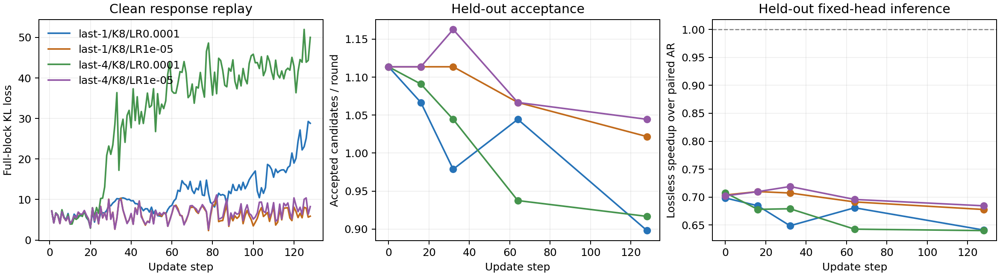

# Qwen3.8 PyPTO：初始化 head 的整块 KL 预热

从 AR 参数复制的 head 尚未学过 MASK 块预测。本实验使用已记录的主模型回答，先做整块 KL 蒸馏，再测固定 head 的实际投机推理。原有基于验证反馈的 TV 在线更新保持不变。

## 实测结果

**真实 27B 的四组实验均完成 128 次更新，但没有获得加速。** 学习率降到 1e-5 后，loss 明显比 1e-4 稳定，最终接受长度仍未提高。

| 更新范围 | 学习率 | test 平均接受候选数：更新前 → 128 步 | 更新后固定 head 吞吐 / AR |
| --- | --- | --- | --- |
| last-1 | 1e-4 | 1.073 → 0.948 | 0.659× |
| last-4 | 1e-4 | 1.073 → 0.958 | 0.660× |
| last-1 | 1e-5 | 1.073 → 1.073 | 0.695× |
| last-4 | 1e-5 | 1.073 → 1.067 | 0.691× |

四组使用相同的初始化、回答记录、随机 anchor 顺序和 8 条 test 题。表中每轮接受数不包含额外交付的 anchor/修正 token；吞吐包含正常起草和验证，关闭学习。全部测试输出逐 token 与同题 AR 一致。

小学习率 last-4 在第 32 步的两条 dev 上曾从 1.114 升到 1.163，最终 test 未复现收益。因此保留首尾 test 与全部中途 dev，不能只取最好的中途点。



每组监督 7,168 个位置，回放训练耗时约 14–22 分钟；另有历史 AR 回答采集约 5.1 分钟，启动和 checkpoint 保存另计。固定 head 已慢于 AR，因此本次不存在可摊销预热成本的加速收益。这只覆盖 45 条回答、末 1/4 层和 128 步的部分层预热，不能据此判断全层预训练或更大训练预算的效果。

原始记录、逐步 CSV 和校验说明见[实验归档](validation/pypto-qwen38/cold-kl-20261110/README.md)。

后续使用[真实反馈数值对照与固定批次训练](QWEN38_PYPTO_TRAINING_DIAGNOSIS.md)区分计算适配与训练设置问题；当前短训练结果本身不能排除实现问题。

## 训练方式

每次更新随机抽取两条完整回答，每条选择四个不同的 anchor。教师始终沿真实文本前进；draft 只能看到 anchor 前的历史和 `anchor + MASK` 块。

```python
# x 是真实 prompt 与主模型回答拼接后的 token 序列。
loss = 0
for answer in sample(clean_responses, 2):
    for a in sorted(sample_valid_anchors(answer, count=4)):
        history = target.prefill_or_advance(answer[:a])
        q = draft([answer[a]] + [MASK] * (K - 1), history)
        # 按真实后续 token 重新计算教师，不能使用拒绝点之后的 verifier 分布。
        p = target.teacher_force(answer[a:a + K], history)
        loss += KL(p[:K - 1] || q[:K - 1]) / (8 * (K - 1))
        target.restore(history)
optimizer.step(loss)  # 只更新指定的 draft 后 N 层，随后发布完整新版本。
```

损失及 logits 梯度在 NPU 上以 PyPTO 显式实现：

\[
\mathcal L=\frac{1}{M}\sum_{b,i}\sum_v p_{biv}\log\frac{p_{biv}}{q_{biv}},
\qquad \frac{\partial\mathcal L}{\partial z_{biv}}=\frac{q_{biv}-p_{biv}}{M}.
\]

其中 \(i=0,\ldots,K-2\)，\(M\) 为本次更新的监督位置总数，\(v\) 遍历完整词表，\(z\) 为 draft logits，\(q=\operatorname{softmax}(z)\)。教师行 \(i\) 使用真实前缀，预测 `answer[a+i+1]`。即使 draft 第一个候选错误，其余行仍有正确监督。

## 对照配置

| 项目 | 配置 |
| --- | --- |
| 基模与初始化 | 真实 Qwen3.8-27B；AR-copy，无离线训练 head |
| 更新范围 | last-1、last-4 分别运行，其他参数冻结 |
| 数据 | GSM8K 训练问题的 45 条 AR-only 已交付回答，每条上限 48 token；沿用已记录的 token 与文件哈希 |
| 块长与批量 | 有效 K=8，底层保留 K32 缓冲；每次更新 8 块，共 56 个监督位置 |
| 预算 | 每组 128 次更新；学习率 1e-4 / 1e-5，前 8 步线性预热 |
| 评估 | 更新前及第 16、32、64、128 步测独立 dev；首尾另测 8 条 test |
| 设备 | TP1 推理卡 + 独立学习卡；参数和 Adam 状态驻留设备 |

这是**部分层更新的冷启动实验**，不是全层离线预训练。数据回放与正常服务请求分开；历史 AR 回答采集耗时和本次回放耗时分别记录。GDN 保持当前因果递推定义，Full Attention 块内双向。

本实验未更新的 draft 前缀与 AR 参数相同，因此只读借用对应设备 bank；待更新后段使用两组独立的驻留参数。更新前后采用相同布局。一般预训练 head 的 Attention 权重可能不同，不能仅因结构相同就借用 AR 参数。

## 运行

在固定 PyPTO/OneServing 环境中运行，两个逻辑设备均须可用：

```bash
PYTHONPATH=src python scripts/benchmark_qwen38_pypto_cold.py \
  --source /path/to/OneServing --model /models/Qwen3.8-27B \
  --data /data/gsm8k --records-report /results/online-last1-k8-128.json \
  --device 0 --learner-device 1 --last-layers 4 --check-kernel \
  --learning-rate 1e-5 --audit-steps 1,16,32 \
  --output /results/cold-last4-k8.json
```

`--records-report` 为 `benchmark_qwen38_pypto_online.py` 完成后的结果文件。本入口只读取其中 AR-only 对照回答，并检查训练分区、原始数据哈希和 token 完整性。改 `--last-layers 1` 运行另一组；`--objective tv` 可用于相同干净监督下的损失对照。

学习率对照使用 `--learning-rate 1e-5 --audit-steps 1,16,32`。诊断步骤在发布新参数后，重算同一批缓存输入的 loss，不再执行 Adam；耗时单独记录，同时仍计入回放墙钟时间。这能区分不同批次的 loss 波动与单次更新是否降低当前目标。

## 验证与指标

502 项 CPU 回归通过，包括独立 autograd 的 KL / last-4 跨三层 GDN 梯度对照、重叠 anchor 的状态恢复和教师输入边界。四组 NPU 预检查均通过完整词表 KL 梯度与小尺寸末层链式反向对照。

真实模型累计完成 512 次更新和 28,672 个监督位置；版本逐次递增，留出集评估不更新参数。首尾 test 和中途 dev 的全部 104 次投机请求均与配对 AR 输出相同，结束时请求队列和 KV 占用归零。检查点与原始训练记录保留在服务器，实验 worker 已退出。

同批 loss 重算有小幅正负变化，原始 `audits` 全部保留；没有把它改写成逐步下降或收敛结论。

效果评估关闭学习，使用正常 draft、验证及拒绝恢复，逐 token 比较同题 AR 输出。报告同时记录 loss、平均接受候选数、固定 head 吞吐和全部回放耗时；教师强制输入时的逐位置匹配率单独命名，不当作实际接受率。只有真实推理快于 AR，才估算摊销预热成本所需的后续 token 数。

启动与最终 checkpoint 保存耗时另列。摊销估算沿用当前请求长度和分布，不代替业务压测。

主要入口：`scripts/benchmark_qwen38_pypto_cold.py`；干净回放：`src/blockspec/pypto_qwen38/cold_replay.py`；损失 kernel：`src/blockspec/pypto_qwen38/training_programs.py::make_kl`。
