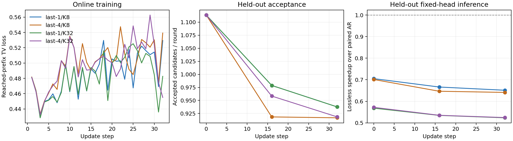
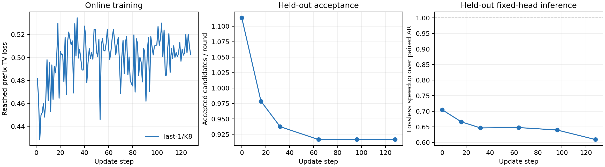

# Qwen3.8 在线更新效果实验

**本页训练效果结论已被真实尺寸反向诊断取代。** 下列实验使用的 PyPTO LM-head 输入梯度实现存在长行读取错误，梯度及参数版本变化并不能证明反向正确。保留原始测量用于追溯，不据此判断 TV 在线更新、冷启动或训练预算的有效性；修复及复验见[数值诊断](QWEN38_PYPTO_TRAINING_DIAGNOSIS.md)。此问题属于本项目的 PyPTO 手写反向路径，不涉及 vLLM 版本的 Torch autograd。

这个实验回答：没有离线训练 head 时，从主模型注意力复制初始化，只更新最后 1 层或 4 层，能否提高接受长度并带来净加速。它使用现有 PyPTO 推理和手写反向链路，不改变 GDN 策略和 reached-prefix TV 目标。

## 数据与对照

使用 [GSM8K 官方数据](https://github.com/openai/grade-school-math/tree/3101c7d5072418e28b9008a6636bde82a006892c)。只读取 `question`，应用模型 chat template、关闭 thinking；数据集答案不作为输入或训练标签。监督来自 verifier 实际到达位置的主模型概率分布。

训练题、调参题、最终测试题按题目内容去重并分开。两个 last-N 实验固定题目顺序、初始化 head、学习率及更新预算，报告原文件 SHA256、分组和 tokenized SHA256。每次评估暂停更新，交错运行同题 target-only 和固定 head；评估数据不进入重放区。

初始化 head 也将对应末尾参数放进更新时使用的设备双缓冲，且不执行优化器步骤。这样更新前后参数驻留方式相同，不会把少上传参数带来的提速误计为学习收益。last-1 和 last-4 各自与自己的初始化及 AR 对照，不能仅根据两组原始 TPS 判断训练方法优劣。

本实验默认让冻结的 AR 复制前段直接引用主模型参数 bank，仍独立执行 draft 的计算；需要保留 FP32 的 `A_log` 单独存放。启用前先对照共享前后的首轮完整 draft logits SHA256 和输出 token，二者必须相同。这项复用只适用于未训练过的 AR 复制前段；可用 `--no-share-ar-prefix` 关闭，不能套用于参数不同的离线训练 head。参数共享前后的耗时独立记录，不计入在线学习收益。

| 设置 | 初始试验 |
| --- | --- |
| 初始化 | 所有 draft mixer 从主模型 AR 参数复制，未加载训练 head |
| 更新范围 | last-1、last-4 分别启动；其余参数冻结 |
| 总上下文 | 512；输入不超过 128 token |
| 起草宽度 | last-1/4 分别比较 K8、K32；另测 4/8/16/32 的理想接受成本 |
| 在线更新 | 32 次；每 8 轮同步更新，重放最近 8 块；独立学习卡存放训练状态 |
| 优化器 | 现有 FP32 Adam、梯度裁剪 1、峰值学习率 1e-4、前 4 步线性预热 |
| 小规模评估 | 每题输出最多 48 token，正常按 EOS 停止；0/16/32 步评估 |
| 保存 | 更新中不落盘，只在末尾保存一次完整 checkpoint |

这里有三个不同的“窗口”：512 是上下文上限；32 是起草块长；8 是重放块数。改变活跃块长不会让当前 K32 padding 的投影、GDN 等计算按比例减少，所以短块是否更快必须实测。

## 指标

同时记录 TV loss、每次更新监督位置数、梯度范数和更新耗时。效果主要看留出题的平均接受候选数（不含 anchor 和纠正 token）、候选接受率，以及相对同题 AR 的输出吞吐。

固定 head 推理和在线净吞吐分别统计。后者包含生成、反馈搬运、反向、优化器及参数发布；加载、编译、预热、评估和末尾 checkpoint 保存单独列出。吞吐为总输出 token / 总耗时。只有逐 token 与 AR 相同，才报告无损加速比。

成本标定仍执行真实 draft，再用目标答案替换候选，测全部接受时的成本上限；只有这项标定忽略 EOS。它不能作为训练效果或实际加速结果。

## 运行

将官方 `train.jsonl`、`test.jsonl` 放在数据目录，可同时提供记录仓库 commit 的 `provenance.json`。在已固定的 OneServing/PyPTO 环境中执行：

```bash
python scripts/benchmark_qwen38_pypto_online.py \
  --source /path/to/OneServing \
  --model /data/disk/models/Qwen3.8-27B \
  --data /data/disk/datasets/gsm8k \
  --device 0 --learner-device 1 \
  --last-layers 1 --steps 32 --eval-steps 0,16,32 \
  --tokens 48 --dev-count 2 --test-count 3 \
  --output /data/disk/results/last1.json
```

将 `--last-layers` 改为 `4` 并指定新的输出路径，独立运行另一组；用 `--width 8` 比较短块。不要传训练过的 head；本入口刻意从 AR 复制初始化。数据准备、参数加载和训练都在同一固定环境中完成，NPU 数量为主模型 1 张、learner 1 张。

延长已完成的 K8 实验时，保持模型、数据和学习超参相同，追加 `--continue-from /data/disk/results/last1-k8.json --steps 128 --eval-steps 32,64,96,128 --train-count 256 --skip-calibration`，并指定新的输出文件。入口恢复 Adam 状态、跳过已使用的问题，保留相同留出集；累计曲线与净吞吐包含前一段训练，不重置学习率预热。

## 32 次更新结果

四组均完成真实 27B 的训练、参数发布、固定 head 评估及 checkpoint 保存。训练请求和留出请求的 greedy 输出均与同题 AR 逐 token 一致；请求结束后 KV block 全部释放。

| 配置 | 测试题接受候选 / 轮：更新前 → 后 | 更新后固定 head / AR | 含更新成本 / AR |
| --- | --- | --- | --- |
| last-1 / K8 | 1.06 → 0.99 | 0.67× | 0.48× |
| last-4 / K8 | 1.06 → 0.94 | 0.66× | 0.29× |
| last-1 / K32 | 1.09 → 0.99 | 0.54× | 0.39× |
| last-4 / K32 | 1.09 → 0.93 | 0.53× | 0.27× |

1× 是同题 AR 基线。K8 减少了验证开销，但这一轮接受长度没有增长，四组均未实现加速。每组只监督了约 500 个位置，TV loss 在 0.5 附近波动；这还不足以判断更长训练的效果。



图中的接受长度和速度来自调参题，表格来自独立测试题。

[完整测量与 CSV](validation/pypto-qwen38/online-effect-20261110/)保留各请求 token、接受数、更新耗时、数据及初始 head 哈希。

## 延长到 128 次更新

选择更新成本较低、调参表现不差于 last-4 的 last-1 / K8，从第 32 步 checkpoint 继续到第 128 步。学习率、重放窗口和更新频率均保持不变，Adam 状态未重置；继续使用新的训练问题，留出题不变。恢复后的第 32 步输出及逐请求接受计数与恢复前相同。

| 更新次数 | 测试题接受候选 / 轮 | 固定 head / AR |
| --- | --- | --- |
| 0 | 1.06 | 0.70× |
| 32 | 0.99 | 0.67× |
| 128 | 1.00 | 0.66× |

累计使用 45 个训练问题，生成 2,160 个 token，监督 2,010 个位置。计入前后两段全部更新成本，累计在线吞吐为 3.20 tok/s，同题 AR 为 7.09 tok/s，即 **0.45×**。梯度与参数版本正常更新、输出与 AR 一致，但延长到 128 次后仍没有观察到加速趋势。



完整状态保存为第 128 步 checkpoint；两台机器上本实验的 NPU worker 和预留进程均已退出。

## 如何解释结果

这是冷启动探索，不等同于已有离线 head 的在线续训。[源仓库](https://github.com/xchang1121/inference_scaling/blob/8d82be93e9874537fc8055a06574f8e25fdc9d39/online-speculation/docs/RUNNING.md) 将两者分开：主线 last-N TV 续训使用预训练 head；AR 复制冷启动实验则使用全量 draft attention、完整回答重放及短块 KL 训练。因此，这里的 last-1/4 若未明显加速，不能直接推断离线 head 的在线续训无效。

128 次更新中，每个训练块平均只有约 1.96 个位置得到监督。回答后面的 token 会在新的 anchor 下继续被训练，但块内较远的预测位置很少得到反馈。因此，下一轮更值得验证的是：保存主模型完整回答的 token，跨请求抽取多个 anchor，用真实前缀重新计算教师分布，对整个预测块进行 KL 蒸馏；具备起草能力后，再进行低频 last-N TV 续训。首次拒绝后的 verifier 分布依赖错误候选前缀，不能直接当作真实后续标签。

从梯度机制看，TV 在师生分布几乎不重叠时可能提供较弱的纠偏信号，KL 更适合进一步作为冷启动对照。这是待验证的解释，本次没有改变训练目标。若末几层的训练容量不足，还需扩大预热阶段的可训练范围；仅增大学习步数或重放块数不能保证解决。

这是少量数学问题、每题最多 48 token 的探索实验，尚未系统搜索学习率和训练预算；结果不等于证明冷启动在线训练不可行。当前证据支持优先改进监督覆盖和预热配方，而非直接长期运行相同配置。
