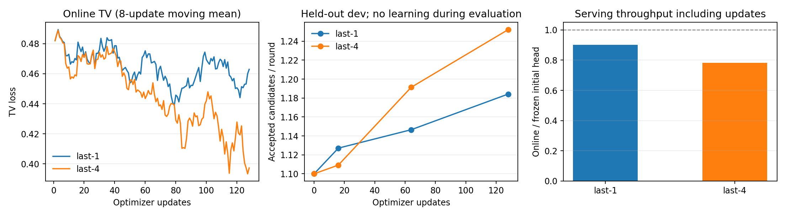

# Qwen3.8 Orthrus 在线更新与推理验证

真实 27B、Ascend A2 上已打通预热 checkpoint 加载、在线更新和 HTTP/SSE 服务。减少无用教师采集后，含更新吞吐从 3.52 提高到 4.22 token/s，64 步后的完整 Adam checkpoint 与对照逐字节一致。固定 head 选择 K=3 后，在 24 道新题上测得 7.56 token/s，同题 AR 为 7.26 token/s，约提高 4.0%。以下分别记录学习效果、实现优化和验收范围。

## 初始化在线学习对照

本实验从主模型复制参数初始化 draft，检查原有 TV 在线更新能否提高独立请求的连续接受长度，以及收益能否覆盖更新成本。last-1 与 last-4 使用相同数据顺序、初始化和超参；各自的第 0 步作为冻结 head 对照。

**两组均完成 128 次真实更新，独立请求的接受长度有所提高，但当前 head 尚未带来推理加速。** last-4 的接受长度改善更多，更新成本也更高。结果来自真实 27B 模型和 GSM8K 请求，没有强制接受候选。

| 指标 | last-1 | last-4 |
| --- | ---: | ---: |
| dev 平均接受候选数 / 轮 | 1.100 → 1.184 | 1.100 → 1.252 |
| test 平均接受候选数 / 轮 | 1.095 → 1.290 | 1.095 → 1.415 |
| test 差值的配对 95% 区间 | +0.148～+0.241 | +0.259～+0.383 |
| 最终固定 head 的 test 吞吐 | 4.39 token/s | 4.53 token/s |
| 同题 AR-only 吞吐 | 7.41 token/s | 7.36 token/s |
| 在线训练期间净吞吐，含更新 | 3.64 token/s | 3.11 token/s |
| 同一组训练题、初始化冻结 head 吞吐 | 4.04 token/s | 3.97 token/s |
| 实际训练题数 / 直接监督位置数 | 36 / 2,171 | 39 / 2,288 |
| 单次更新耗时中位数 | 0.480 s | 1.569 s |

共核对 230 个投机请求、14,720 个输出 token，包含学习期间请求、冻结评测和初始化对照，均与同题 AR-only 的 greedy 输出逐 token 一致。两组发布版本连续、梯度有限，冻结评测期间参数与优化器步数不变；最终 checkpoint 保存成功，两个实验均正常退出。这里确认的是当前单请求、K32、短上下文路径，不扩展为所有部署规格的验收。



图中 TV 是不同反馈批次的移动平均，不是固定批次损失。区间按留出题目配对重采样计算，只反映题目间的不确定性；本轮没有重复多个训练随机种子。

## 固定条件

| 项目 | 设置 |
| --- | --- |
| 模型与运行时 | 真实 Qwen3.8-27B；固定 OneServing / PyPTO；主模型与学习器各一张 A2 |
| 数据 | GSM8K 真实问题；不将数据集答案送入模型或监督 |
| 划分 | 1 题校准、4 题 dev、12 题 test、128 题候选训练流；题目哈希隔离，seed=42 |
| 请求长度 | prompt ≤128 token，生成最多 64 token，总上下文 ≤512 |
| 预测块 | 最大有效 K=32，物理缓冲 K32；每轮最多 31 个候选，临近输出预算时按调度裁剪 |
| 更新 | last-1 / last-4，各 128 次；每 8 轮用 8 个反馈块更新一次 |
| 监督 | verifier 实际触及的前缀，完整词表 TV；拒绝后的错误前缀不作监督 |
| 优化器 | FP32 Adam，学习率 1e-5，前 8 步线性预热，全局梯度裁剪 1.0 |
| 评测 | 第 0、16、64、128 步；中间仅 dev，首尾测 dev 和 test；评测暂停更新 |

训练流使用相同顺序，但接受长度会影响每个请求产生的轮数。因此固定 128 次更新，同时记录实际题数、监督位置数及每块有效行数，不将它们当作相等的训练量。

本轮只更新末 1 / 4 层，前 63 / 60 层 draft 参数仍与 AR 相同，因此直接引用对应 AR 参数，末段参数驻留在独立 bank。这里复用的是尚未改变的 draft 参数；若未来的离线 head 已改变前面各层，就不能套用这条参数共享路径，需要按实际 head 的驻留或分片配置重新测量。

## 评测方法

主指标为每轮平均接受的连续候选数（不含主模型补充 token），同时保留候选接受比例、生成吞吐及逐请求明细。每道留出题均配对运行 AR-only，要求输出 token 完全一致。冻结评测还检查 head 版本和优化器步数保持不变。

完成学习后，使用同一组训练请求额外测一次初始化冻结 head。控制路径只读主模型的原始参数来重现 AR-copy head，校准题的 draft logits SHA256 必须与第 0 步相同；对照期间不写参数、不改变优化器状态。这样能直接比较同题的“冻结 head 推理”和“含更新成本的在线请求”。

更新算子沿用已验证的共享传输、有效教师行和长词表反向实现。实验期间只在结尾保存 checkpoint，写盘与模型启动耗时单独记录。

## 反馈覆盖与后续实验

每组共使用 1,024 个反馈块。last-1 各候选位置获得直接监督的块数依次为 `[1024, 995, 151, 1, 0, ...]`；last-4 为 `[1024, 993, 249, 22, 0, ...]`。在线监督集中在较短的 verifier 可达前缀，较远位置主要通过共享参数和双向 Attention 获得间接梯度。

关闭更新后的最终 head 仍慢于 AR，因此仅降低更新频率不足以让当前 head 加速。为检查稠密监督的作用，选择 dev 改善较多的 last-4，使用训练划分的完整 AR 回答做整块 KL 预热，再在未用于预热的问题上验证原有 TV 在线更新。每步密集监督 248 个候选位置，而初始化在线对照每步约为 17～18 个，因此这不是单独比较 KL 和 TV 两种 loss。

预热后的接续实验使用 dev 作选择，这组 12 题 test 作为探索性对照；另预留 24 个未使用测试题，只评估预先指定的最终 head。预热与接续结果分别记录如下。

初始化在线对照的 last-4 最终 head 每轮耗时约 0.545 s；按同题 AR 吞吐估算，每轮约需交付 4.0 个 token 才能追平 AR。这只是对应工作负载下的成本估算。接续实验保持 K32 做训练与首尾对照，再在最终固定 head 上用 dev 比较 K=4、8、16、32 的真实吞吐，选出的活跃宽度仅在额外 24 题上确认。物理缓冲与编译规格仍为 K32，不重新训练 head，不强制接受候选。

## 补充验证与预热入口

统计入口同时记录各候选偏移获得直接教师监督的次数。这与梯度覆盖不同：较远位置仍能经共享参数和双向 Attention 获得间接梯度。

离线整块预热可使用 `benchmark_qwen38_pypto_cold.py --answer-only --width 32`。它只读取本轮训练划分的已交付 AR 回答，从回答内选择 anchor，并保证完整预测块不越过回答末尾；回答过短的样本明确计入排除范围。默认全文采样方式保留。

该入口的数据隔离和采样检查已通过 545 项 CPU 回归。满块长词表输入梯度也已在 NPU 上独立核对：32 行稠密输入的相对 L2 误差为 0.000103，最后一行、词表末尾的单点输入结果精确一致。两者均使用现有 PyPTO 反向实现，不涉及 Attention 算法调整。

预热效果与在线对照分别记录，不能把密集监督带来的收益归因于某一个 loss 的替换。

### 整块 KL 预热结果

last-4 在 36 道训练问题的完整 AR 回答上完成 128 次更新，共 1,024 个预测块、31,744 个直接监督位置。dev 平均接受数从 1.100 到 1.230，test 从 1.095 到 1.323；test 配对差值的 95% 区间为 +0.169～+0.290。40 个冻结评测请求均与 AR 逐 token 一致。

第 1、64、128 步分别重算了同一批次更新前后的 KL，依次为 `9.307→9.303`、`4.553→4.504`、`4.022→3.962`。完整重放耗时 975.6 s，其中更新占 176.7 s；历史 AR 回答收集耗时为 312.4 s，本轮直接复用这些回答，没有再次收集。

最终固定 head 的 test 吞吐为 4.42 token/s，同题 AR 为 7.39 token/s。整块监督也带来了泛化改善，但本轮小预算实验未观察到比原 TV 在线训练更高的接受长度，仍需把 head 质量与验证器开销分别评估。原始记录与独立核对结果见 `raw/kl-answer-last4-k32-128-r1.json`、`prewarm-summary.json`。

## 验证器编排对照

原生 verifier 以 16 行为一个 tile。完整 K32 路径会计算两个 tile，再按第一次拒绝的位置回滚；分块路径在第一个 tile 已拒绝、遇到 EOS 或用完输出预算时，不计算后续 tile。两者提交同一段 AR 输入，仍使用原生前向、快照和回放，没有修改数值 kernel。

在同一份 last-4 TV checkpoint 上，4 道 dev 各重复两次、交替测试顺序：

| 指标 | 完整验证 | 分块早停 |
| --- | ---: | ---: |
| 固定 head 吞吐 | 4.30 token/s | 5.39 token/s |
| 平均接受数 / 轮 | 1.252 | 1.252 |
| 主模型验证与回放的 tile 调用数 | 610 | 440 |
| 验证与回放耗时 | 81.57 s | 57.98 s |

整体吞吐提高 25.5%，两组的候选数、接受数及交付的 512 个输出 token 均完全一致；同题 AR 为 7.42 token/s，因此此处的 25.5% 是相对完整验证路径的改善，尚未追平 AR。默认的在线教师采集仍保留完整验证；下节另测显式启用前缀采集的实现。

CPU 验证覆盖全部 5,376 种拒绝/EOS/预算/tile 组合，并检查分页回收与循环状态回放。后端接入后的整套 CPU 回归为 577 项；新增入口检查另为 41 项。独立 NPU 结果见 `raw/tiled-verifier-last4-dev-r1.json`。

## 预热后的在线更新与教师采集对照

从 KL 预热 checkpoint 恢复权重、清零 Adam 后，在未用于预热的 22 道问题上完成 64 次 last-4 TV 更新。12 题 test 的平均接受数从 1.323 到 1.766，配对差值的 95% 区间为 +0.386～+0.511；K32 固定 head 吞吐从 5.48 到 6.41 token/s，同题 AR 为 7.36 token/s。

为减少在线采集的无用计算，增加显式的前缀采集选项：在已执行的原生 tile 内覆盖全部受监督行后，跳过拒绝之后的 tile；回滚重放期间不重复追加教师数据。干净回答的离线整块监督保持不变。

| 同一请求流、同一 64 步更新 | 完整教师采集 | 前缀教师采集 |
| --- | ---: | ---: |
| 在线净吞吐，含更新 | 3.52 token/s | 4.22 token/s |
| 直接监督位置数 | 1,272 | 1,272 |
| 逐步 loss / 梯度范数 / 裁剪比例 | 与右侧逐值相同 | 与左侧逐值相同 |
| 最终 FP32 master 和两组 Adam 动量 | 完整 payload SHA256 相同 | 完整 payload SHA256 相同 |

两组分别使用同一节点的 0/2 和 3/4 卡。请求、接受结果和更新计划完全一致，吞吐改善约 20.0%；按各自同题 AR 吞吐归一后为 19.5%。结果与状态比对见 `teacher-capture-comparison.json`，不是通过更少训练标签获得的收益。

在最终固定 head 上，dev 的 K=4/8/16/32 吞吐分别为 6.56/6.34/6.20/6.13 token/s，因此选择 K=4。额外 24 道独立确认题为 6.60 token/s，同题 AR 为 7.34 token/s，全部输出逐 token 一致。这组小预算 head 在已测配置上仍未超过 AR；后续的小窗口实验另用新的确认题。

## 小窗口与独立确认

保持上述 64 步后的 head 不变，在同一组 dev 上比较 K=2、3、4；每题重复两次，交替候选配置的测量顺序。每种配置交付 512 个 token，全部与 AR 一致。head 不重新训练，评测期间参数和优化器计数保持不变。

| 活跃 K | dev 吞吐（token/s） | 起草耗时 / 轮 | 验证及回放耗时 / 轮 |
| --- | ---: | ---: | ---: |
| 2 | 6.75 | 130 ms | 130 ms |
| 3 | 7.08 | 131 ms | 184 ms |
| 4 | 6.44 | 129 ms | 239 ms |

同题 AR 为 7.29 token/s。K=2 每轮交付较少，K=4 的拒绝回放成本较高；K=3 在 dev 中吞吐最高，因此固定它，再用 24 道新题确认。这 24 题与全部训练、开发、探索性测试及原确认集均不重叠。

新确认集交付 1,536 个 token，全部与 AR 逐 token 一致。K=3 为 **7.56 token/s**，同题 AR 为 **7.26 token/s**，吞吐比为 **1.0405**；按题目配对重采样的 95% 区间为 **[1.0120, 1.0695]**。每轮平均接受 1.587 个候选，不含 AR 补充 token；候选接受比例为 79.7%，对应每轮最多两个候选，不能与 K32 的候选比例直接比较。

这是当前 head 和请求分布上的小幅加速，并不代表其他业务或部署规格也会提高 4%。测量为同节点逐题配对，节点同期有其他卡上的任务；区间反映题目差异，没有覆盖重复训练与独占节点性能的变动。物理执行仍按 K32 组织，起草耗时没有随候选数同比降低。原始请求、分阶段耗时与独立核对结果为 `raw/width-refinement-last4-k234-r1.json`、`width-refinement-summary.json`。

## 复现与权重接续

在线对照入口为 `scripts/benchmark_qwen38_pypto_online.py`。主参数为 `--last-layers 1` 或 `4`、`--steps 128 --eval-steps 0,16,64,128 --width 32 --tokens 64 --stride 8 --replay-blocks 8 --learning-rate 1e-5 --warmup-steps 8 --frozen-stream-control --skip-calibration`。

同一入口的 `--warm-from <已完成预热的 JSON> --confirm-count 24` 用于加载预热权重后，以新优化器进行 TV 在线更新。它排除预热用过的问题，保留原 dev/test，并检查设备上的 master 参数与 checkpoint 逐值相同、Adam 动量为零、更新计数从零开始。该选项与保留 Adam 状态的 `--continue-from` 含义不同，也不使用仅适用于 AR-copy 初态的 `--frozen-stream-control`。

增加 `--sweep-widths 4,8,16,32` 后，以 dev 的总 token / 总耗时选择最终活跃宽度，再对确认集运行一次。接受长度与候选接受比例一并记录，但不将较高接受比例直接当作较高吞吐。

固定 head 的小窗口确认使用 `benchmark_qwen38_pypto_verifier.py --checkpoint-report <在线实验JSON> --widths 2,3,4 --data <GSM8K目录> --confirmation-count 24 --tokens 64 --repeats 2`，并指定 `--source`、`--model`、两个设备及新输出路径。它保留原 dev，排除该 JSON 已记录的旧 test/confirm，另取新的确认题；不更新权重。每题结果原子保存，异常退出不记为通过。

`--continue-from` 恢复在线实验的完整 Adam 状态，也保留预热题排除名单和留出集，从尚未使用的训练问题继续。旧确认集不会作为新的独立确认再次运行；恢复数据划分的真实 tokenizer 检查及新增 CPU 用例单独记录。

服务入口 `scripts/serve_qwen38_pypto.py` 对应使用 `--online --resume-online <checkpoint目录> --reset-online-optimizer`。省略最后一个选项则恢复原 Adam 状态继续训练。两种方式均严格检查基模、模板 head 和 last-N 参数布局，不接受不匹配的 checkpoint。

对本轮从 AR-copy 初始化的末段 checkpoint，可省略 `--head-dir`，以 `--share-ar-prefix` 引用未训练的前段参数；指定外部 head 目录时禁止使用该选项。示例：

```bash
python scripts/serve_qwen38_pypto.py \
  --source /data/OneServing --model /data/models/Qwen3.8-27B \
  --device 0 --learner-device 1 --online --last-layers 4 \
  --resume-online /data/heads/warm.checkpoint --reset-online-optimizer \
  --share-ar-prefix --verification-backend tiled --partial-teacher-capture \
  --attention-backend paged --gdn-backend vector \
  --draft-group-size 4 --head-transfer packed
```

服务默认使用 `warn` 级别运行时日志；需要逐次 kernel 计时记录时，显式增加 `--runtime-log-level timing`。

`--draft-width N` 可将活跃块宽度设为 2～32，默认 32；它改变每轮候选数，不改变已编译缓冲或 head 格式。宽度应按实际请求吞吐选择，不能只看候选接受比例。

该服务入口已用真实 27B 和预热 checkpoint 完成 HTTP 验证：加载后的 master 与文件一致、Adam 动量清零、推理卡参数与学习器一致。普通输出与 SSE 各生成 64 个 token，均与 AR 参照逐 token 相同；服务期间完成 7 次在线更新，head 版本从 0 增至 7，请求队列清空后服务正常关闭。

启用前缀采集、关闭逐 kernel 日志后重复上述服务验证，输出及最终 loss、梯度范数、裁剪比例与原服务逐值一致。所有 64 层均已有独立参数引用时，启动阶段释放不再使用的初始上传缓冲：释放 909,889,408 字节，实测 NPU 可用内存增加 910,163,968 字节（约 868 MiB）。只释放本服务拥有且不被替代参数引用的存储，外部 head 的有效参数不受影响。该版本通过 600 项 CPU 回归；服务结果与对照摘要为 `raw/warm-service-last4-prefix-r3.json`、`service-prefix-summary.json`。

结果原始记录、独立汇总与监督器退出状态位于 [实验记录目录](validation/pypto-qwen38/online-study-20261111/)。权重 checkpoint 保留在实验服务器，未将模型参数提交到仓库。
