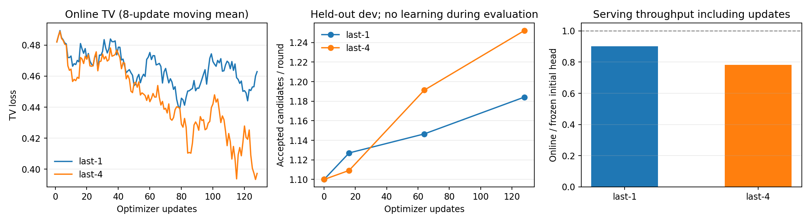

# Qwen3.8 Orthrus 在线更新与推理验证

本文记录真实 Qwen3.8-27B 在 Ascend A2 上的在线更新、固定 head 推理和服务验证。各节保留对应日期的配置和结果。

## 全程持续更新的验收口径

从第一条请求开始，持续按间隔更新直到请求流结束，在线全流吞吐必须同时比同条件纯 AR、同起点固定起草提高超过 5%（2026-11-20 更新的双基线验收口径）。前者衡量总加速，后者衡量在线学习的净增量，两个条件均须满足。主验收实际使用两张物理卡、TP2，在线学习复用其中一张卡。反馈收集、重放、前反向、优化器、权重发布和流末尾未完成更新的等待均计入时间。固定组与在线组使用相同主模型配置、题目顺序和生成设置，分别从同一起点恢复；在线组的参数和优化器状态跨请求保留。

SQL、GSM8K、Pseudo2code 分别记录。三卡独立学习器属于扩展资源的辅助实验：固定阶段即使预留第三张闲置卡，也不能把它视为与两卡方案等效的计算资源，更不能用于宣布两卡 +5% 目标达成。每组保留 AR、初始冻结 head、全程持续更新、限步后停更、最终冻结 head 原题重跑，以及最终 head 的独立留出评测。原题重跑属于已见题诊断，不能代替持续更新结果。每项如实记录收益，当前 SQL 的限步策略结果尚不能证明持续更新已达标。

调参只使用探索请求。选定配置后固定参数，在预留新请求上重新排序、独立恢复三条学习流；报告全流 token 总数除以总耗时，以及各条流相对 AR 和固定起草的结果。每条流及三条合并后，对两个基线的增量都必须超过 5%。未达标的数据集继续分析学习收益和更新成本，不截取有利片段充当全流结果。

预留确认由统一复核后选择的单一配方启动；各机器不独立自动消费同一预留队列，防止不同配方或不同资源设置重复利用确认数据。三卡的后续自动确认已撤销，当前在途三卡完整流仅作辅助诊断，之后切换到两卡实验。

长流确认使用 `gsm8k-confirm384-clean-v2.json`。在尚未生成任何确认结果前，对照历史训练、校准和评测的问题 ID，替换原待用池中 14 个已出现过的问题，其余顺序保留。新池共 384 题，与探索、原 256 题待用池及最终留出题均无交集；只根据问题来源和输入长度划分，不根据输出或速度筛选。原待用池保留作为追溯记录，正式确认不再使用。来源与排除目录随 `gsm8k-confirm384-clean-v2-manifest.json` 保存。

三条历史配方确认均已完成。它们使用同一份 step128 head、两张 A2、TP2、greedy、K32 物理块和最多七个候选，每条包含 384 道预留题；只改变请求顺序，分别清空 Adam，始终周期更新并计入反馈、训练、发布和尾部等待。各组生成 72,086 token，greedy 与 AR 一致，发布导出精确一致。

| 顺序种子 | AR tok/s | 初始固定起草 tok/s | 持续在线 tok/s | 在线相对 AR | 在线相对固定起草 |
| --- | ---: | ---: | ---: | ---: | ---: |
| 743 | 31.937 | 29.732 | 31.968 | +0.10% | +7.52% |
| 744 | 32.217 | 30.178 | 32.244 | +0.08% | +6.85% |
| 745 | 32.805 | 29.965 | 32.471 | -1.02% | +8.36% |
| 合并 | 32.315 | 29.957 | 32.226 | -0.28% | +7.57% |

因此，相对固定起草约 7%～8% 的收益不能作为验收通过；**相对 AR 的三次和合并增量均未达到 5%**。这些请求已经用于确认，不再拿来调参或作为新配方的首次独立评测。三条分别完成 441 / 442 / 440 次更新，各发布 110 次，均无停更上限；最终冻结同题重跑、独立留出及逐请求对计时详见 `gsm384-reserved-confirmation-audit.json` 和对应原始记录。该历史测量的 AR 为单独完整流，后续统一增加逐对 AR 交错对照。

[参考实现的在线实验](https://github.com/xchang1121/inference_scaling/blob/a9b78f71965c07ee1b524f9b71e2a93bb170718e/docs/RESULTS.md#L53-L96)使用全程周期更新，temperature=1、完整词表、K32、last-1、TV，每 16 个验证轮次更新并发布，独立重置三条学习流。评测先对齐上述完整计时和持续更新口径；greedy 与 temperature=1 分开记录。模型大小、并发、候选上限、学习率等差异必须注明，不能将当前 greedy 测量称为完整复现实验。

测试入口 `benchmark_qwen38_oneserving_tp2_online.py --continuous-updates` 拒绝同时设置 `--max-updates`。结果标记为 `continuous_periodic` 或 `capped_then_frozen`，保存逐对请求的耗时、输出量、更新次数、发布次数和版本，以及最终更新轮次和异步忙碌跳过次数。

### 相邻请求对照

参考实现逐题交错运行不同方法。对于两卡同步更新，新增 `--interleaved`：每两个请求组成一对，分别用初始固定 head 和持续更新 head 生成，并交替安排哪组先运行。两组仍各自按原顺序完成整个请求流，分别累计实际输出量与服务时间，避免将整段固定起草与整段在线运行之间的负载变化误当成学习收益。原有布局保留，结果分别标记为 `interleaved_pairs` 和 `separate_streams`。

初始和更新后的 bank 已常驻设备，切换在 runner 线程只更换引用，不上传权重，也不重置 Adam。固定组暂停反馈与更新回调，保留在线组的优化器、轮次、replay 和延迟反馈窗口；恢复在线组后继续学习。当前只允许一个更新间隔、同步学习，拒绝后台学习，避免在固定组计时期间免费完成训练。三卡后台学习仍单独报告，不混作该布局的结果。

164 项 CPU 回归通过。真实 27B、TP2 上的 greedy 和 temperature=1 各完成 6 条请求、8 次更新，固定组的反馈、更新和发布均为零，在线版本跨请求继续前进；greedy 与 AR 相同，训练回放 TV 为 0.00000432，发布 head 的导出重建精确一致。短诊断使用 K32、最多 7 个候选，不作为收益结论；完整 31 候选请求流另行评测。证据见 `v17-interleaved-validation.json`。temperature=1 仍使用前述 CPU 采样入口。

完整 Pseudo2code 56 题的两卡交错对照已完成：AR-copy 起点、TV 3e-5、last-1，先每 4 轮更新 32 步，再持续每 32 轮更新，固定组为 7.833 tok/s，在线组为 8.116 tok/s，净增 **3.61%**，共 110 次更新，尚未达到门槛。此前相同配方、相同物理卡的分段测量为 +3.25%。两次记录的前 76 步 loss、梯度范数、裁剪、学习率及轮次相同，后续存在差异，最终 head 也不同；不能声称两种布局的完整学习轨迹已经证明等价。对照记录见 `paired-v17-learning-comparison.json`。

修正源码后的同配方串行复测为 **8.259 → 8.513 tok/s，净增 3.08%**。本次与上述交错测量的 110 步 loss、梯度范数、裁剪比例、学习率及更新轮次全部相同，最终 head payload SHA256 也相同；因此这两次之间的增量差异属于计时变化，不能解释为训练退化。完整记录见 `pseudo-source33-serial-comparison.json`。两卡采样重叠的 TV 6e-5 探索也已完成 56 题：8.233 → 8.307 tok/s（+0.90%），114 次更新及发布，仍未达标；该项同时改变学习率，不能用它单独判断重叠调度是否有效。

GSM8K 128 题、step128、TV 1e-5、先每 16 轮更新 32 步再每 64 轮更新的两卡交错对照，也已完成：9.944 → 10.249 tok/s，净增 **3.06%**。与同配方的分段测量相比，131 步的 loss、梯度范数、裁剪、学习率、监督行数和轮次全部相同，最终 head payload SHA256 也相同，但分段测量的增量是 +3.83%。这组记录直接说明计时布局会影响增量，不能仅凭单次正收益宣布达标；见 `gsm128-interleaved-legacy-comparison.json`。

GSM8K 官方 train 的 384 题长流，两卡交错对照已完整完成：**29.039 → 30.819 tok/s，净增 6.13%**，两组各输出 72,071 个 token，逐 token 一致。使用 step128 起点、greedy、K32（最多七个候选）、last-1、TV 1e-5、补齐七个教师位置；先每 16 轮更新 256 步，再持续每 128 轮更新，每四步发布。共 444 次更新、111 次发布，最后更新后剩 30 轮，没有限步或停更阶段，所有反馈、训练和发布成本均计入。32 题留出评测中，初始/最终固定 head 分别为 30.320、32.604 tok/s。AR 只抽测 16 题，不能据此计算完整 384 题对 AR 的加速比。

这是一项两卡探索结果，尚不等于正式验收，也不是 temperature=1 的参考实验复现。已锁定同一配方，在干净的 384 题预留流上独立恢复、打乱顺序三次确认；确认同时补齐全流 AR、最终 head 已见题重跑及独立留出，不再根据确认结果调整此配方。复核记录见 `gsm384-two-card-exploration-review.json`。

另两项分段探索也已完成：GSM8K 128 题、两卡、step128、TV 1e-5，先每 16 轮更新 32 步再持续每 64 轮，为 9.778 → 10.153 tok/s（+3.83%，131 步）；Pseudo2code 56 题、三卡、KL 1e-5，先每 4 轮更新 64 步再持续每 16 轮，为 9.981 → 10.188 tok/s（+2.07%，183 步）。均未使用预留题确认，也不将这三项混合计算收益。

### 双卡采样空档中的同卡更新

可选的 `--overlap-sampling` 将 last-1 或 last-4 学习放到 CPU 按需采样的空档，学习器仍使用 TP2 的 rank0，不增加第三张卡。先把本次候选的概率行读到独立 CPU 缓冲，再提交已验证反馈的训练；CPU 采样与设备训练并行，下一次设备调用前等待训练完成并统一发布。候选概率保留本次真实起草时的值，不会因中途换 head 而改变 rejection sampling 的依据。固定组切换前及请求对完成前均结清任务，不能把训练成本转移到固定组或计时区间外。

该选项只用于 temperature=1 的 lazy 采样，默认关闭，不支持独立学习卡。266 项 CPU 回归和首轮真实 27B 两卡测试通过：六条数学/EOS 混合请求共输出 272 token，完成 33 次更新，其中 31 次在采样窗口启动；回放最大 TV 为 0.000000090，导出参数精确一致，每对请求完成时无排队或执行中的更新，固定组反馈、更新和发布均为零。延迟补齐七个教师位置的同类测试也通过：18 次更新，回放最大 TV 为 0.000000407，导出精确一致，请求对完成时也无遗留任务。这些短测试含额外回放诊断，不能据此计算吞吐收益。详见 `v33-sampling-overlap-validation.json`。

完整 56 题的重叠对照现已完成：AR-copy 起点、last-1、TV 3e-5，初始固定 head 为 **8.047 tok/s**，持续在线为 **8.324 tok/s（+3.44%）**。111 次更新中，110 次在 CPU 采样期间启动、一次在结束边界执行；最后一次更新后仅剩六轮，没有限步或停更。导出参数重建精确一致，仍未达到 +5%。该调度比串行测量多一次更新，学习轨迹不完全相同，不能把 +3.08% 与 +3.44% 的差值全归为隐藏训练开销；见 `pseudo-source33-overlap-summary.json`。

采样预取进一步限定为“确有待启动更新”时才复制 logits，普通在线轮次沿用直接读取，避免无用副本；固定评测原本就不做这项预取。267 项 CPU 回归以及真实两卡的普通、延迟反馈检查通过，分别完成 33、18 次更新。两项检查的全部 loss、梯度范数、裁剪、监督行数、调度与回放字段均与改动前相同，最终两份 rank 权重文件 SHA256 也相同。完整请求流的计时单独进行，不用高频更新短检查报告吞吐改善；见 `v51-prefetch-validation.json`。

last-4 也完成了实际两卡的同卡更新检查：454,944,000 个 draft 参数在 rank0 学习，六条数学/EOS 请求完成 10 次更新，回放最大 TV 为 0.000768、相对 L2 为 0.005134；发布后导出精确一致，请求对结束时没有遗留更新。第一步的 loss、梯度与回放和同步版本相同，之后因发布滞后一轮，整条轨迹不能视为相同。叠加大词表分块的 temperature=1 检查与整合版本的 greedy 检查通过；整合版本的 temperature=1 首次启动被宿主机全局 OOM 杀死，未产生吞吐结果，保留失败记录并重新安排。见 `v38-last4-overlap-validation.json`、`v54-partial-service-validation.json`。

按需预取版本的 Pseudo2code 完整 56 题为 **8.390 → 8.624 tok/s（+2.79%）**，完成 111 次更新并正常退出。与原重叠版本的完整运行相比，前 64 次更新数学字段相同，后续随机生成轨迹和最终 head 不同；不更新的固定组从首对请求也出现了接受数差异。因此不能把这两次吞吐的差值归因于单独的复制优化，短检查的逐值相同也不扩大为整条随机流的逐值相同。原始记录和比较见 `pseudo-source51-prefetch-full-summary.json`。

### 全词表损失分块

将 TV/KL 向量核每次处理的词表项数从 512 调为 2560，在保持目标、有效位置和归一化不变的前提下，减少大词表循环。真实末层权重的完整 last-1 前反向，TV 为 37.317 → 34.102 ms，KL 为 35.946 → 33.757 ms。last-4 用同样的真实参数及合成激活复测，TV 为 102.932 → 100.853 ms，KL 为 102.309 → 100.637 ms；本次两个目标下的 33 组参数均有非零梯度，前向 logits 和这些梯度在两种分块间逐位相同。该相等结论限于本次输入，last-1 对照仍有小量舍入差异。

这些是单张卡上的完整后段前反向计时，不包含 Adam、反馈和发布，不能直接当作在线全流改善。CPU 分块及相关回归 90 项通过；双卡服务的回放、发布及导出复验另行执行，已经锁定的 GSM8K 确认仍使用原有源码快照。源码、两次 last-4 实测和全部原始样本见 `loss-tiles/`。

2560 分块的真实两卡服务检查已完成 greedy 和 temperature=1 两项：各运行六条数学/EOS 请求，分别完成 19、18 次更新。greedy 输出与 AR 逐 token 相同；两项回放最大 TV 均为 0.000000407、相对 L2 为 0.002963，发布参数导出精确一致，固定组无学习工作，请求对结束时无遗留更新。首轮底层启动失败另存，重新启动后的两项检查正常结束；KL 与多块 replay 继续分别验证，见 `v46-device-service-validation.json`。

### EOS 对齐

验证一次计算至多四行，但请求可能在第二行就输出 EOS。此前 reached 反馈仍可能包含 EOS 后的验证行，接受数与缓存提交也可能越过实际交付边界。现在先截取真实交付前缀，再让监督行数、接受数和缓存提交使用同一边界；需要回退时调用已有 C4 快照恢复，并停止验证后续块。随机验证接受 EOS 后也立即停止，不再读取后续目标分布。默认的忽略 EOS 模式不变。

176 项 CPU 回归通过。真实 27B、两卡、K32、31 候选的 greedy 与 temperature=1 各完成六个短请求和八次更新，回放平均 TV 为 0.00000327，发布参数导出重建精确一致；greedy 与 AR 相同。另用真实 draft 前向、受控 AR 候选触发块内接受 EOS，确认三次监督都准确截止到已交付的三个位置，并读取两张卡的十二个相关 bank，确认初始参数未修改、更新参数与待发布值逐位相同。受控候选只用于正确性检查，不作为接受率或吞吐收益。完整证据见 `v18-eos-validation.json`；采用修正前源码的探索记录保留原标签，不混作修正后的正式验收。

### 验证分块的实验选项

`--verify-chunk-size` 可选择一次向现有目标前向提交一、二或四行，默认仍为四行。K32 起草块、目标模型 prefill 上限及原生 C4 快照容量不变，也不生成新的 Attention 算子。较小的分块可能少计算拒绝点之后的行，但接受较长前缀时会增加完整目标模型调用次数，因此须比较实际吞吐，不能仅凭每次处理行数少就判定更快。固定组与在线组在每项对照中使用相同行数。

256 项 CPU 回归覆盖不同分块的拒绝、bonus、EOS、预算及非退化采样分布。两行分块已完成真实 27B 两卡测试：greedy 六题共 384 token，与 AR 相同；采样测试混合数学题和短 EOS 请求，六题共 272 token。两组分别完成 23、45 次更新，回放 TV 为 0.00000432、0.000000090，导出重建精确一致。它们是正确性检查，不是分块性能对照，详见 `v20-verify2-validation.json`。一行选项也已完成对应的真实 27B 两卡验证：greedy 与 AR 相同；greedy/采样两组分别完成 23、43 次更新，训练回放及发布参数导出检查通过，详见 `v20-verify1-validation.json`。默认配置仍为四行。

### 同反馈的多步更新

`--inner-steps` 默认为 1，可在一次反馈事件中用相同的已验证 teacher/history 连续做多次 Adam 更新。每一步都使用新参数重新前向和反向，不重复使用旧梯度；学习率预热按实际 Adam 步数计算。发布间隔和可选步数上限必须是组内步数的整数倍，避免把一组末尾的权重误标为中途版本。完整组结束后在原请求边界提交，失败不会把半组参数切入服务；后台模式也等待该组完成再发布。

评测分别保存反馈事件数、真实更新步数、不同反馈位置数及重复计算的梯度位置数，全部训练与发布时间计入在线组。188 项 CPU 回归通过，真实 27B 两卡上，两步 greedy 配置完成 14 步、7 次发布，输出与 AR 相同；四步 temperature=1 配置完成 24 步、6 次发布，15 个真实反馈位置对应 60 次梯度位置计算。两组均正常退出，回放和导出参数检查通过。这些短测试只验证更新链路，收益须由独立完整流决定，见 `v19-inner-steps-validation.json`。

Pseudo2code 56 题的完整两卡交错实验中，同反馈每次更新两步，AR-copy 起点、TV 3e-5，8.171 → 8.129 tok/s，净增 **−0.52%**；99 次反馈事件完成 198 次 Adam 更新与 99 次发布，直到流末仍按间隔更新。导出参数精确重建。对应单步配方此前为 +3.61%，本轮不支持通过简单增加同反馈更新次数提高净吞吐，默认仍为一步；详见 `pseudo-inner2-summary.json`。

### Last-4 的完整流探索

GSM8K 128 题、step128、temperature=1、last-4 全部 draft 参数、延迟补齐七个教师位置、TV 1e-5，在线组采用 TP2 加独立学习一卡；固定起草实际只用 TP2，第三张卡虽被保留但没有计算，因而不是两卡同资源对照。先每 16 轮更新 32 步，再持续每 64 轮更新，每八步发布。完整流为 **10.393 → 11.215 tok/s，净增 7.91%**，完成 122 步、15 次发布，最后一次更新后只剩 21 个验证轮次，没有步数上限。本轮优化器执行到第 122 步，服务使用第 120 步已发布参数，导出 head 的累计 step 为 248（128 + 120）；最后两步的训练成本也已计入。此结果仅说明增加专用学习卡后的变化，不满足主验收。

该轮使用修正前的源码、分段测量布局，属于探索结果。16 条独立留出请求的冻结 head 吞吐从 10.503 升至 12.036 tok/s；未执行原题重跑。AR 仅抽测 16 条，不能与 128 条完整流计算全流 AR 加速比。修正版复测继续保留为辅助诊断，不安排三卡预留确认；主验收转为两卡持续更新。原始记录为 `a111-v13-gsm128-t1-last4-tv1e5-dense7-warm16x32-retry2.json`。

修正版已在相同 A 机环境完成 last-4 后台更新短验证：greedy 与 AR 相同，两次更新正常完成，回放平均 TV 为 0.00000368，导出参数重建精确一致。初始化期间曾出现测试用显存保留进程在确认释放后退出超时；测试脚本现使用幂等、有界的退出流程，仅回收它自己创建的子进程，不重置设备或终止其他任务。四项 CPU 清理场景、单卡 16 GiB 保留与释放实测，以及上述真实三卡服务验证均已通过。模型计算代码与 EOS 修正版相同；详见 `v28-background-validation.json` 和配套脚本。完整 128 题修正版复测也已完成：10.562 → 11.280 tok/s（+6.79%）；仍属于三卡辅助实验，不能用于两卡验收。last-4 的两卡内训练也已完成容量和数值检查：454944000 个 draft 参数在 rank0 更新，TP2 服务复用同两张卡，六条数学/EOS 请求完成 11 次更新，回放与发布后导出检查通过。该短测试不用于收益判定，见 `a2-last1-last4-service-validation.json`。原始记录为 `a111-v28-gsm128-t1-last4-tv1e5-dense7-warm16x32-r1.json`。

两卡同步 last-4 的完整 128 题交错对照已结束：**10.074 → 10.473 tok/s（+3.96%）**，共 123 次更新、15 次发布，流末仍按计划更新，导出参数重建精确一致。两组都实际使用两张卡，学习器位于 rank0，尚未达到 +5%。本轮反馈、训练与上传直接耗时共 71.04 s；在保持相同输出和学习轨迹、假设这些耗时完全消失时，条件估算增量为 +8.93%，不是实测收益。后续重叠调度必须重新实测，不能据此预报达标。三卡记录使用不同执行布局和学习轨迹，也不能把两项结果的差值完全归因于额外学习卡；见 `a2-last4-full-gsm128-summary.json`。

## 2026-11-19 SQL 全流对照

### 持续周期更新补测

同两张 A2、TP2、同 `step160` 起点，在完整 256 条请求上保持更新直到流结束。其余配置与下方限步实验相同，分别从同一起点恢复，未设置更新次数上限。

| 指标 | 每 16 轮更新 | 每 64 轮更新 |
| --- | ---: | ---: |
| 同配置 AR | 23.24 tok/s | 23.24 tok/s |
| 初始固定 head | 23.44 tok/s | 23.44 tok/s |
| 持续在线更新，含全部更新成本 | 23.77 tok/s | 24.86 tok/s |
| 相对初始固定 head | +1.40% | +6.03% |
| 更新次数 / 发布次数 | 338 / 169 | 96 / 48 |
| 最后一次更新后剩余验证轮数 | 1 | 36 |
| 最终 head 冻结后原题重跑 | 27.32 tok/s | 26.48 tok/s |

两组均完成完整 18,178 个输出 token，greedy 输出与 AR 一致，流结束时没有触及步数上限。每 64 轮的结果达到探索阶段的 +5% 目标，尚待独立重置、变更请求顺序和预留请求确认；不视为所有数据集已达标。三卡独立学习器的本轮补测在 AR 第 109 对请求发生运行时错误，没有进入在线阶段，不计为有效在线测量。

### 新数据集探索结果

| 数据与学习方式 | AR | 初始固定 head | 在线全流 | 相对固定起草 |
| --- | ---: | ---: | ---: | ---: |
| GSM8K，128 题，KL，64 步后停更 | 31.55 | 34.59 | 32.16 | −7.04% |
| GSM8K，128 题，TV，128 步后停更 | 31.46 | 34.62 | 33.16 | −4.23% |
| Pseudo2code，56 题，KL，48 步后停更 | 19.72 | 21.08 | 20.57 | −2.39% |

表中吞吐单位为 tok/s，均为两卡 TP2、last-1、greedy、同起点配对测量。这些限步试验用于选择下一轮配置，不满足持续更新的验收口径。GSM8K 的 KL 试验连最终固定 head 也低于初始固定 head；TV 最终 head 略有改善，仍不足以覆盖本轮更新成本，因此下一轮比较 TV、更新频率和 AR-copy / step160 起点。

GSM8K 来自官方 test 问题；Pseudo2code 来自 LongProc 官方 0.5k 数据，保持原始提示，仅选取输入加 128 个输出 token 能放入当前 512 总上下文的子集，不能称为完整 LongProc 评测。探索、留出和预留确认请求分开，数据集答案不用于在线反馈。原始 JSON、数据 manifest、请求和汇总保存在[本轮实验记录](validation/pypto-qwen38/online-datasets-20261119/)。运行时失败单独保留，不填充缺失吞吐。

后续探索保留普通 TV，同时提供 `--focus-weight 4` 的加权对照。它只提高反馈中实际触及的第 3、4 个候选位置的 TV 权重，其余位置保持权重一；梯度按整批有效监督权重之和归一化，另记真实位置数，拒绝后未验证的位置仍不参与监督。默认权重一保持原目标。该接入及已有独立梯度参考的 22 项 CPU 测试通过，性能效果须由对应 NPU 实验确认。TP2 在线、后段反向、采样数学等原有相关回归共 85 项通过。

TV 学习率 `1e-4` 的持续更新补测也未达标，所有结果均计入更新及发布开销。

| 数据 / 资源 | 每 32 轮更新相对固定起草 | 每 64 轮更新相对固定起草 |
| --- | ---: | ---: |
| GSM8K，128 题，两卡 TP2 | −11.00% | −10.26% |
| Pseudo2code，56 题，两卡 TP2 | −12.68% | −5.09% |
| Pseudo2code，56 题，TP2 加独立一卡学习器 | −1.92% | −5.25% |

另用真实 `step160` 权重在 CPU 上核对 FP32 master、渲染精度与 TP2 发布布局的零更新往返，last-1 的 12 个 rank bank、last-4 的 30 个 rank bank 均与原推理 bank 逐元素相同。这排除了零更新时分片及归一化参数转换引入差异的情况，不代替训练重放或实际 NPU 更新的数值检查。

下一轮优先测 temperature=1、完整词表、TV、学习率 `1e-5` 的持续更新，并对比 AR-copy、整块 KL 预热的 step128 与 step160 起点。temperature=1 的当前入口仍在 CPU 上执行完整词表采样，主模型和学习器使用 PyPTO；两组采用相同采样入口，不能将它称为全设备采样结果。该试验已经前移到 SQL 重复之前。

### 延迟反馈与训练回放核对

延迟反馈现已接入 TP2 服务。先保存旧 anchor 的 draft 输入和历史状态，再沿后续实际交付的正确前缀收集教师分布。第一次拒绝后，等待修正后的真实生成继续向前，不能直接采用错误候选分支后面的分布。`--teacher-tokens` 可设置 1～31 个监督位置；遇到 EOS 或预算耗尽，只保留真实有效行。物理起草块仍为 K32，监督长度与实际提出的候选数分别记录。

真实 27B、TP2 上已完成以下回放核对：

| 配置 | 实际 draft 与训练回放的平均 TV | logits 相对 L2 | top-1 一致率 |
| --- | ---: | ---: | ---: |
| step160，31 个教师位置 | 0.000132 | 0.002791 | 100% |
| step128，7 个教师位置 | 0.001186 | 0.002693 | 100% |
| step160，last-4，7 个教师位置 | 0.000768 | 0.005134 | 100% |

第一组保持原教师分布，同批 TV 从 0.835475 降至 0.835148；第二组仅将训练教师温度设为 0.25，同批 KL 从 4.59444 降至 2.52804。last-4 组同批 KL 从 10.54375 降至 8.86469，TV 略升，不能把 KL 降低写成 TV 降低。这说明重放基本重现了实际起草计算，且更新能降低当前批次的目标；不代表独立请求的接受率或净吞吐已经提高。训练教师锐化后的 TV 不能与原始 AR 分布的 TV 混用。诊断额外执行完整回放和 logits 回传，其吞吐不作性能结论。

配套加入按实际 Adam 步数预热、可选 inverse-sqrt 衰减，以及将同一验证块的两份词表分片合并后一次上传。训练教师温度不改变目标模型的验证概率或请求的生成温度。这些路径及延迟反馈、采样边界共 64 项 CPU 测试通过。

按需采样还完成了真实 27B 的两卡测试：K32、最多 31 个候选、temperature=1，固定起草为 11.450 tok/s；原来全块预采样的 32 题对照约为 3.438 tok/s。两者请求数不同，因此这里只确认瓶颈改善，正式性能对照另在同一完整请求流测量。新测试的训练回放 TV 为 0.00000432、top-1 一致率 100%，完成两次更新并正常退出。该测试开启了额外回放诊断，在线吞吐不作为验收收益。

当前两卡服务还复验了 step160、temperature=1、最多 31 个候选的延迟监督：六条数学/EOS 请求完成七次更新，每次直接监督 8～31 个真实后续位置，训练回放最大 TV 为 0.0000426、相对 L2 为 0.002756，最终发布参数导出精确一致。请求对完成时无遗留更新，固定组没有反馈、训练或发布工作。该短检查包含额外回放诊断，不用于吞吐结论；完整 56 题对照另行运行，见 `v57-teacher31-validation.json`。

`--export-heads` 可在完整请求流结束后，将实际已发布的两份 TP head 导出，保存时间单列。导出按现有 TP2 后四层 head 格式还原参数，再重建推理 bank 逐元素核对；不使用尚未发布的 Adam master。真实 step160 参数加模拟更新后的 42 个 bank 往返均精确一致，另有 6 项接口与布局测试通过；真实 27B、TP2 已完成更新后的导出，重新构造的发布 bank 全部精确一致，且 greedy 输出与 AR 相同。由导出 head 重新开始的实验默认重置 Adam，不能标为恢复了优化器动量。

### 持续更新的新增对照

| 数据 / 起点 / 资源 | 固定起草 tok/s | 持续更新 tok/s | 净增量 |
| --- | ---: | ---: | ---: |
| GSM8K 128 题，AR-copy，TV 1e-4，两卡，每 32 轮 | 27.411 | 25.285 | −7.76% |
| 同上，每 64 轮 | 27.411 | 26.381 | −3.76% |
| Pseudo2code 56 题，step160，TV 3e-5，三卡，每 64 轮 | 21.565 | 21.449 | −0.54% |
| GSM8K 32 题，step160，temperature=1，TV 1e-5，两卡，每 16 轮 | 3.438 | 3.427 | −0.32% |
| 同上，三卡 | 3.471 | 3.425 | −1.33% |
| GSM8K 128 题，step128，KL / 教师温度 0.25，两卡，每 32 轮 | 29.090 | 28.936 | −0.53% |
| 同上，每 64 轮 | 29.090 | 29.080 | −0.03% |
| Pseudo2code 56 题，step160，last-4 KL / 教师温度 0.5，三卡，每 64 轮 | 21.010 | 20.972 | −0.18% |

上述均为完整请求流、持续周期更新，无步数上限。GSM8K 的 temperature=1 对照每题最多输出 64 token，32 题共交付 2,048 token；三卡组只完成 43 次更新、110 个直接监督位置。其完整词表采样仍在 CPU 上运行，不能将该路径称为全 PyPTO 设备采样。

后续探索固定两项改动：沿真实后续前缀补齐前 7 个位置的监督，以及预热后衰减学习率；greedy 另测较尖锐的训练教师。temperature=1 增加按需采样，只在 verifier 将要触及下一组候选时生成这些候选，保留原有 rejection sampling 分布。新增的 384 题长流来自 GSM8K 官方 train，预留 test 确认题保持独立。超过探索门槛的配置须从同一起点，在预留请求上独立重置三次确认；单次探索正收益不视为最终达标。

新增的 Pseudo2code 对照仍使用 LongProc 官方 0.5k 输入模板和完整伪代码，只将输出预算设为 64 token。按输入加输出不超过 512 的条件筛选，再按问题 ID 去重；排除全部预留确认及留出 ID 后，以 seed=94617 选择 96 题。该组用于更多不同请求的前缀吞吐评测，不是完整程序生成质量评测，不能与原 56 题、128-token 组混为一项结果。确认组继续使用预留题，并采用相同的 64-token 配置。

整块 KL 预热 step128 起点、TV 1e-5 的两卡完整 128 题对照也已完成：每 32 轮更新净增量为 −0.68%，每 64 轮为 +0.05%；对应最终冻结 head 重跑为 32.747、31.969 tok/s，初始固定 head 为 29.245 tok/s。学习提高了接受数，当前短流的净吞吐仍未达到 5%。384 题长流另安排同长度的 384 题预留确认，不用较短的 256 题替代长流确认。

### 更新参数范围的对照

默认 `--parameter-scope full` 保留所选 last-N 层全部 draft attention 参数的更新。另提供两种显式实验范围：`norms` 只更新 draft attention 自己的 Q/K norm 和 GDN 输出 norm；`output_norms` 再加入这些层的输出投影。共享 backbone 的 norm 和 MLP 始终冻结，推理结构、目标模型和验证分布不变。两种范围均使用同一原始 head 和全新 Adam，不等同于继续恢复原全参数优化器。

| 更新范围 | last-1 参数量 | last-4 参数量 |
| --- | ---: | ---: |
| norms | 512 | 896 |
| output_norms | 31,457,792 | 125,830,016 |

显式训练图按所选梯度保留必要节点，删除不会影响这些梯度的投影 dW 等计算；冻结路径上仍然需要的 dX 不会删除。只有改变的推理 bank 参与发布，其他 bank 继续引用原 head。冻结的 draft 投影作为训练常量加载，其内存也计入预检。此处是更新策略和成本的实验选项，不能仅凭参数量小就声称学习效果或净吞吐更好。

CPU 上用独立 autograd 对照 FP32 / BF16、TV / KL 和 last-1 / last-4，裁剪图的前向、loss 和保留参数梯度与完整图逐元素一致，相关回归共 99 项通过。真实 head 的六种范围 / 层数组合共 68 个 rank bank 完成零更新往返，均精确一致。真实 27B、两卡还完成了以下短诊断：

| 范围 / 层数 | 实际起草与回放的 TV | top-1 一致率 | greedy 与 AR 相同 | 导出重建与发布 bank 相同 |
| --- | ---: | ---: | --- | --- |
| norms / last-1 | 0.00000432 | 100% | 是 | 是 |
| norms / last-4 | 0.000768 | 100% | 是 | 是 |
| output_norms / last-1 | 0.00000432 | 100% | 是 | 是 |

`output_norms` 在学习率 `1e-4` 的第一个诊断批次上，TV 从 0.70830 升至 0.76783，因此该步没有改善目标。后续保留高学习率记录，并补测 `1e-5`；梯度正确不等于任意学习率都有收益。短诊断含额外回放，吞吐不作性能结论。完整请求流仍按同起点、同资源和持续更新口径验收。

### 训练提交开销与持续更新频率

last-1 的显式训练图改为一次 HOST 入口提交，替代按 24 个节点拆分的三次提交。计算节点、梯度缓冲和优化器不变；last-4 仍使用有界分段，单入口也检查运行时参数数量上限。真实 head 和真实模型形状、合成 hidden/history/teacher 的 NPU 对照如下，使用与 TP2 学习器相同的 flat gradient views：

| 更新范围 | 三次入口中位耗时 | 单次入口中位耗时 | 耗时减少 |
| --- | ---: | ---: | ---: |
| full / last-1 | 41.15 ms | 38.36 ms | 6.8% |
| norms / last-1 | 37.88 ms | 35.06 ms | 7.4% |
| output_norms / last-1 | 37.56 ms | 34.75 ms | 7.5% |

每种配置预热后测量 8 次；前向 logits、loss 和所有选中参数梯度逐位相同，TV loss 另与 Torch 参考核对。这里仅计训练图执行，不包含完整反馈和发布，不能当作在线吞吐提升。源码、逐次计时和梯度差异记录在 `dispatch-compare-flat-20261119.json` 及同目录脚本。

更新频率另支持 `--warm-update-stride` 与 `--warm-update-steps`：先按较密间隔更新，完成指定 Adam 步数后改为较疏间隔，直到请求流结束，始终没有步数上限。结果标为 `continuous_two_stage`，与固定频率和限步停更分开。真实 27B、两卡短诊断已完成轮次 8、16、32 的三次更新，记录间隔为 8、16、16；greedy 与 AR 相同，最终发布参数导出重建精确一致。当前相关 CPU 回归 107 项通过。

完整流结果仍未达到目标：GSM8K 128 题、step128、延迟补齐 7 个教师位置、TV 1e-5，更新间隔 32 / 64 的净增量分别为 −0.82% / −0.01%。Pseudo2code 56 题、AR-copy、补齐 31 个位置、TV 1e-5、间隔 64 为 −5.88%，平均接受数从 1.180 降至 1.150。更多监督位置没有自动转化为更高接受率。GSM8K 的 `output_norms`、TV 1e-4、间隔 16 完成完整 128 题后为 −10.75%；该多配置任务随后主动停止，原始记录明确区分已完成配置和未完成任务。

### 发布参数的设备布局

last-1 的 Q/K/V 行分片在渲染缓冲中已经连续排列，直接按 allocation base 和显式 offset 回传；O 投影在设备上按列分片，Q/K norm 在设备上复制成两份。回传后仍在相同请求边界一次发布两个 TP rank，优化器和版本协议不变。独立学习器在 fork 前登记这些共享 DMA 目的缓冲。

真实 `step160` head 的独立 NPU 对照中，所有发布 bank 逐位一致。下表包含布局计算和设备到主机回传，不包含后续两个 serving rank 的上传：

| 更新范围 | CPU 整理及回传中位耗时 | 设备布局及回传中位耗时 |
| --- | ---: | ---: |
| full / last-1 | 150.41 ms | 20.90 ms |
| output_norms / last-1 | 52.58 ms | 7.33 ms |
| norms / last-1 | 0.42 ms | 1.18 ms |

因此 `auto` 仅对 last-1 的 full / output_norms 使用设备布局，norms 和 last-4 保留 CPU 路径；`cpu`、`device` 可显式指定作对照。相关 CPU 回归 156 项通过。真实两卡服务与 CPU 发布对照的两次更新中，loss、梯度范数、裁剪比例、接受数及轮次相同，最终发布 head 的完整 payload SHA256 相同，greedy 与 AR 一致，正常退出。三卡后台学习器也已通过真实 27B 的训练回放、greedy 对照和发布后导出检查，回放 TV 为 0.00000432，重建 bank 精确一致。完整在线收益继续单独测量，不能将发布阶段约七倍提速写成端到端提速。

对已经完成的两卡同步 GSM8K 128 题、间隔 32 的记录拆分后，反馈、更新和上传共占 46.32 秒，其中 CPU 整理占 9.15 秒，总流耗时 819.88 秒。`update_ns` 已含读取和整理，不能再累加完整 `publish_ns`。这说明发布优化只能收回部分成本，还需要足够的学习增益和合适的更新频率。异步学习器的计算与生成会重叠，不能直接用同样的耗时减法估算收益。

last-4 的独立排布实验也已完成：真实 step160 参数的 15 个 bank 均逐位相同，源参数缓冲未改变，进程正常退出。八次交错测量中，CPU 排布及回传中位数为 **795.41 ms**，设备排布及回传为 **81.69 ms**；很小的 decay/bias 仍在主机整理。该计时不包含上传两个 serving rank，服务集成仍需回放、发布和导出检查，不能作为在线全流收益。三版 kernel 源码、前两次编译失败和最终退出记录保存在 `publication-last4/`。

首次 last-4 设备发布服务因显存预检中止：计入暂存区后，距离原安全门槛还差 76,039,904 字节。随后将已经连续排列的 Z rank 切片直接回传到最终主机 bank，减少 **180 MiB** 设备副本；安全余量和模型配置保持相同，设备排布暂存区降为 582,211,072 字节。293 项 CPU 回归通过，两套固定运行环境的独立 NPU 检查均确认 15 个 bank 与 CPU 参考及原版本逐位相同、源参数未变并正常退出。各自交错测量的 CPU / 设备中位耗时为 **392.48 / 71.78 ms** 和 **883.35 / 134.00 ms**，不能跨环境直接比较。该版本实际两卡服务在随后加载冻结 MLP 时仍因设备显存不足中止，不能据独立排布检查宣称整链路通过；见 `publication-v4-memory-validation.json`、`c67-pub-v4-native-audit-r1.json` 与 `publication-last4/v4/`。

### Temperature=1 的完整流结果

Pseudo2code 使用完整 56 题、每题最多 128 个输出 token、K32、step160 起点、last-1、TV 1e-5、replay 1、每四步发布。TP2 推理加独立一卡学习器，固定组和在线组均使用同一组三张物理卡；周期更新持续到流结束，未设置步数上限。

| 配置 | 固定起草 tok/s | 在线全流 tok/s | 净增量 | 更新次数 | 平均接受候选数 / 轮 |
| --- | ---: | ---: | ---: | ---: | ---: |
| 每 16 轮更新 | 10.006 | 10.382 | +3.75% | 132 | 1.634 → 1.834 |
| 每 64 轮更新 | 10.006 | 10.317 | +3.10% | 34 | 1.634 → 1.703 |

两组正常结束，净收益包含反馈、训练、发布和末尾等待。它们说明持续更新已有正收益，尚未达到 +5% 门槛，因此没有据此使用预留确认题。该组仍采用 CPU 发布布局和四 token prefill 上限；后续配置另行比较，不混合汇总。temperature=1 的完整词表采样由 CPU 执行，主模型和学习器使用 PyPTO。普通 AR 只抽测 16 题，不能将其与上述 56 题直接计算全流加速比。原始逐请求记录见 `a111-v11-pseudo56-t1-tv1e5-reached-3card-r1.json`。

设备发布的后续三卡对照在同一 56 题上先每 8 轮更新，完成 64 次 Adam 更新后改为每 16 轮，持续到流结束，每步发布。固定起草为 10.027 tok/s，在线为 10.453 tok/s，净增 +4.26%；共更新 163 次，最后一次更新后只剩 4 个验证轮次，没有限步停更。最终冻结 head 原题重跑为 10.838 tok/s，属于已见题诊断。该配置已正常完成，记录为 `a111-v13-pseudo56-t1-tv1e5-warm8x64-pub1-r1.json`。

将最初间隔进一步缩短为 4、其余保持上述策略的完整 56 题探索，净增为 +3.57%，共更新 178 次。平均接受数为 1.897，高于前一配置的 1.866，但完整流没有更快。因此，更密的更新不能只凭接受长度判断吞吐收益。该轮保留更新后留出评测和 head 导出，探索阶段省略已见题重跑；预留确认仍恢复完整对照。

三卡的 TV 3e-5、replay 4、每 16 轮更新并立即发布，完成同一 56 题后为 10.026 → 10.500 tok/s（+4.73%），更新 129 次，平均接受数从 1.632 升至 1.901。两卡从 AR-copy 起点、TV 3e-5、先每 4 轮更新 32 次再持续每 32 轮的对照为 7.820 → 8.074 tok/s（+3.25%），更新 110 次。两项均正常完成，仍是整段分开测量的探索结果，未达到预留确认门槛，不能混合两卡和三卡计算收益。

GSM8K 的两卡同步对照使用 step128、last-1、TV 1e-5、K32、同一组 64 条请求、每题最多输出 128 token，并按 EOS 停止；每四步发布，全程持续更新。固定起草为 9.415 tok/s，每 16 轮更新为 9.414 tok/s（−0.01%，214 次更新），每 64 轮为 9.830 tok/s（+4.41%，55 次更新）。两种配置均正常完成，仍未达 +5% 门槛。记录为 `v11-gsm64-t1-tv1e5-reached-2card-r1.json`。

每 64 轮更新的设备发布复测为 10.006 → 9.952 tok/s（−0.54%）。两次使用同两张物理卡，55 步的 loss、梯度范数、裁剪、学习率、监督位置、更新轮次，以及最终发布 head 的完整 SHA256 全部相同；接受数和验证轮数也相同。设备发布缩短了更新耗时，但冻结基线的总时间从 870.07 秒变为 818.68 秒，在线总时间从 833.33 秒变为 823.15 秒。因此，单次 +4.41% 尚不能视为稳定的学习净增益，需由独立重复确认。完整核对见 `gsm64-t1-publication-paired-check.json`。

从 AR-copy 开始的实际两卡 KL 探索使用同一套 Pseudo2code 56 题、temperature=1、last-1 和周期更新策略：

| KL 学习率 / 调度 | 固定起草 tok/s | 持续在线 tok/s | 全流净增量 | 更新次数 |
| --- | ---: | ---: | ---: | ---: |
| 3e-5 / constant | 8.038 | 8.342 | +3.79% | 111 |
| 1e-4 / inverse-sqrt | 8.370 | 8.627 | +3.08% | 111 |

两组均计入全部学习和发布成本，持续更新至最后一个正常周期，未限步停更，最终发布参数导出精确一致。均未达到 +5%，未消费预留题。原始与汇总为 `pseudo-kl3e5-overlap-summary.json`、`pseudo-kl1e4-decay-overlap-summary.json`。

上述三条冷启动 TV/KL 流均完成 111 次更新，但实际只监督了 237～251 个位置，平均每步约 2.1～2.3 个。更多有效标签和更新 last-4 的对照因此继续进行；反馈、训练及上传计时之和为 13.71～18.12 秒，其中部分与采样重叠，不能直接从流耗时减去这些数值估算收益。逐项核对见 `pseudo-feedback-cost-analysis.json`。

延迟监督 31 个位置的两卡完整对照也已结束：step160、last-1、TV 3e-5、56 题，固定为 **9.262 tok/s**，持续在线为 **9.112 tok/s（−1.62%）**。54 次更新共监督 1,479 个真实位置，平均每次 27.39 个；全流平均接受数从 1.634 到 1.596。增加真实标签没有在该配方上改善净吞吐，后续继续比较 last-4 和 replay 组合。发布导出与请求末尾结清检查通过，未使用预留题；见 `pseudo-teacher31-full-summary.json`。

GSM8K 的另一条两卡 temperature=1 探索使用 step128、last-1、TV 3e-5、replay 2：完整 128 题固定起草 **10.152 tok/s**，持续在线 **10.552 tok/s（+3.95%）**，完成 152 次更新并正常退出，发布导出精确一致，仍未达到 +5%。该组与已锁定的 greedy 长流确认分别记录，未据此调整预留确认配方；见 `gsm128-t1-replay2-full-summary.json`。

### 长流运行时故障定位

有些长流在固定 head 阶段就以 `507018` 退出，尚未执行在线更新。已从对应设备日志定位一组可重复故障：ring 2 的 256 MiB 临时任务池只剩 3.5 MiB，下一次申请需要 6 MiB，最终报 `Task Allocator Deadlock - Heap Exhausted`。这证明临时池分配与回收停滞，尚不能仅凭此认定全部故障都只是容量不足；设备日志也提示需区分容量不足与消费者停滞。

增加 `--ring-heap-mib 512` 作为明确的复验配置。只提高各任务池的下限，保留更大的原生预算和原有内存预检，不修改驱动或全局运行时。AR、冻结起草和在线组使用相同预算，结果保存完整资源策略。C 节点已完整跑完包含原失败位置的前 24 题、持续更新和最终冻结重跑，正常退出；更长流的稳定性继续单独确认。异常记录保留因果链，清理失败也会保存已完成配置和原始错误，不把中途退出计为完整流结果。证据见 `runtime-ring-heap-diagnosis.json`。

三个节点均已通过真实 27B、两卡的单入口训练、回放和发布后导出短诊断。另准备 GSM8K 的 1,024 题长流：探索取官方 train 的索引 2,048～4,999，独立保留请求取 5,000 以后，均排除已测 384 题，按固定种子和输入长度选择，不使用答案或生成表现筛题。这是吞吐研究的 train 分区划分，不是官方 test 准确率评测；请求及来源索引随 manifest 保存。

### 关闭学习器与 prefill 路径的独立核对

关闭在线反馈后，JIT 仍会解析反馈分支中的层号比较。原先的 `None` 被当作非数值类型，导致纯推理图编译失败；现使用数值哨兵 `-1`，正常训练层号保持不变。真实 27B、TP2、不创建学习器的测试已编译并执行：在四 token prefill 下，AR 重跑、真实 draft，以及绕过 draft 计算的已知正确候选验证，输出全部相同。相关 CPU 回归 156 项通过。

另单独尝试了放宽 prefill，而不改变四行验证宽度。在同一个隔离进程中，prefill 上限为 0（原生预算）、16、32 时，关闭 draft 的 AR 重跑本身也从首 token 起出现差异；切回上限 4 时，上述三种对照均一致。纯原生 `serving.runtime.TensorParallelRunner`、不加载 Orthrus 模型或 head 的额外对照又出现 `507018`，未完成重复输出检查，不能用这次异常替代数值归因。因此未合入放宽 prefill 的实验，收益试验继续统一使用已验证的上限 4。实验补丁、原始结果和完整脚本保存在 `prefill-budget-experiment.patch`、`b167-prefill-target-isolation-r2.json` 及 `prefill-diagnostics/`，与有效在线吞吐结果分开。

### 限步后停更对照

256 条 WikiSQL 请求均为首次进入该在线流，每条要求对同一张表生成三个 SQL 查询。20 条留出请求使用另外的题目和表。该输入组织是为本实验构造的多查询负载。所有组使用同一份问题、同一顺序和同一份 `step160` 起始 head，分别执行完整 256 条请求，共输出 18,178 token。

| 全流吞吐 | 两卡共卡更新，111 | 两卡推理加一卡训练，61 |
| --- | ---: | ---: |
| 普通 AR | 24.24 tok/s | 23.68 tok/s |
| 冻结初始 head | 23.94 tok/s | 23.82 tok/s |
| 更新 64 步后停更，完整首次请求流 | 26.61 tok/s | 26.34 tok/s |
| 限步策略相对初始固定起草 | +11.16% | +10.57% |
| 限步策略相对 AR | +9.74% | +11.22% |
| 冻结最终 head，重跑原 256 条请求 | 27.61 tok/s | 26.14 tok/s |

两卡组使用 NPU 1、7，三卡组使用 NPU 4、5 推理、7 训练。生成均为 TP=2、同时两个请求、BF16、greedy、无 prefix cache，最大总上下文 512，每条最多输出 192 token并按 EOS 停止。物理起草块为 K32，每轮最多提出 7 个候选。

学习器更新最后一层 draft attention 的 Q/K/V/O 与 Q/K norm，FP32 Adam，完整词表 KL，学习率 `1e-4`，每 16 个验证轮次重放 2 个反馈块，每 2 步发布一次。累计更新 64 步后停更，继续测量后续新请求。两卡组同步更新，三卡组使用独立学习器并行更新。两边均完成 64 步和 32 次发布。起始 head 的训练 payload SHA256 为 `bb02eeffcf9e23b84ad2f8694bbe3fd9ab7e9406ee4c51d3f8eac6f99f565f82`。

上述限步策略的吞吐从第一条请求开始计时，包含更新 64 步后停止学习的后续生成，模型加载、编译和预热另计。这组结果不用于证明全程持续更新达标。最终 head 重跑发生在本条流完成以后，计时只包括固定推理，这些请求已经参与过该 head 的学习。独立留出评测期间关闭更新，结果如下。

| 20 条独立留出请求 | 两卡组 | 三卡组 |
| --- | ---: | ---: |
| 普通 AR | 23.29 tok/s | 22.99 tok/s |
| 初始固定 head | 23.56 tok/s | 23.39 tok/s |
| 最终固定 head | 25.93 tok/s | 25.08 tok/s |
| 最终 head 相对初始 head | +10.08% | +7.24% |

所有 greedy 请求均与配对 AR 逐 token 一致，固定重跑期间更新与发布计数均为零，两个实验均正常退出。两卡和三卡在不同节点完成，增益各自使用本机基线。上述数值来自单条学习轨迹。重复请求顺序与其他数据集的结果应另行验证。

完整记录、输入、留出题和来源 manifest 保存在[SQL 实验记录](validation/pypto-qwen38/online-sql-20261119/)。原始 JSON 保留逐段全流吞吐、每步更新、参数哈希、卡号和完整耗时。

## 初始化在线学习对照

本实验从主模型复制参数初始化 draft，检查原有 TV 在线更新能否提高独立请求的连续接受长度，以及收益能否覆盖更新成本。last-1 与 last-4 使用相同数据顺序、初始化和超参；各自的第 0 步作为冻结 head 对照。

**两组均完成 128 次真实更新，独立请求的接受长度有所提高，但当前 head 尚未带来推理加速。** last-4 的接受长度改善更多，更新成本也更高。结果来自真实 27B 模型和 GSM8K 请求，没有强制接受候选。

| 指标 | last-1 | last-4 |
| --- | ---: | ---: |
| dev 平均接受候选数 / 轮 | 1.100 → 1.184 | 1.100 → 1.252 |
| test 平均接受候选数 / 轮 | 1.095 → 1.290 | 1.095 → 1.415 |
| test 差值的配对 95% 区间 | +0.148～+0.241 | +0.259～+0.383 |
| 最终固定 head 的 test 吞吐 | 4.39 token/s | 4.53 token/s |
| 同题 AR-only 吞吐 | 7.41 token/s | 7.36 token/s |
| 在线训练期间净吞吐，含更新 | 3.64 token/s | 3.11 token/s |
| 同一组训练题、初始化冻结 head 吞吐 | 4.04 token/s | 3.97 token/s |
| 实际训练题数 / 直接监督位置数 | 36 / 2,171 | 39 / 2,288 |
| 单次更新耗时中位数 | 0.480 s | 1.569 s |

共核对 230 个投机请求、14,720 个输出 token，包含学习期间请求、冻结评测和初始化对照，均与同题 AR-only 的 greedy 输出逐 token 一致。两组发布版本连续、梯度有限，冻结评测期间参数与优化器步数不变；最终 checkpoint 保存成功，两个实验均正常退出。这里确认的是当前单请求、K32、短上下文路径，不扩展为所有部署规格的验收。



图中 TV 是不同反馈批次的移动平均，不是固定批次损失。区间按留出题目配对重采样计算，只反映题目间的不确定性；本轮没有重复多个训练随机种子。

## 固定条件

| 项目 | 设置 |
| --- | --- |
| 模型与运行时 | 真实 Qwen3.8-27B；固定 OneServing / PyPTO；主模型与学习器各一张 A2 |
| 数据 | GSM8K 真实问题；不将数据集答案送入模型或监督 |
| 划分 | 1 题校准、4 题 dev、12 题 test、128 题候选训练流；题目哈希隔离，seed=42 |
| 请求长度 | prompt ≤128 token，生成最多 64 token，总上下文 ≤512 |
| 预测块 | 最大有效 K=32，物理缓冲 K32；每轮最多 31 个候选，临近输出预算时按调度裁剪 |
| 更新 | last-1 / last-4，各 128 次；每 8 轮用 8 个反馈块更新一次 |
| 监督 | verifier 实际触及的前缀，完整词表 TV；拒绝后的错误前缀不作监督 |
| 优化器 | FP32 Adam，学习率 1e-5，前 8 步线性预热，全局梯度裁剪 1.0 |
| 评测 | 第 0、16、64、128 步；中间仅 dev，首尾测 dev 和 test；评测暂停更新 |

训练流使用相同顺序，但接受长度会影响每个请求产生的轮数。因此固定 128 次更新，同时记录实际题数、监督位置数及每块有效行数，不将它们当作相等的训练量。

本轮只更新末 1 / 4 层，前 63 / 60 层 draft 参数仍与 AR 相同，因此直接引用对应 AR 参数，末段参数驻留在独立 bank。这里复用的是尚未改变的 draft 参数；若未来的离线 head 已改变前面各层，就不能套用这条参数共享路径，需要按实际 head 的驻留或分片配置重新测量。

## 评测方法

主指标为每轮平均接受的连续候选数（不含主模型补充 token），同时保留候选接受比例、生成吞吐及逐请求明细。每道留出题均配对运行 AR-only，要求输出 token 完全一致。冻结评测还检查 head 版本和优化器步数保持不变。

完成学习后，使用同一组训练请求额外测一次初始化冻结 head。控制路径只读主模型的原始参数来重现 AR-copy head，校准题的 draft logits SHA256 必须与第 0 步相同；对照期间不写参数、不改变优化器状态。这样能直接比较同题的“冻结 head 推理”和“含更新成本的在线请求”。

更新算子沿用已验证的共享传输、有效教师行和长词表反向实现。实验期间只在结尾保存 checkpoint，写盘与模型启动耗时单独记录。

## 反馈覆盖与后续实验

每组共使用 1,024 个反馈块。last-1 各候选位置获得直接监督的块数依次为 `[1024, 995, 151, 1, 0, ...]`；last-4 为 `[1024, 993, 249, 22, 0, ...]`。在线监督集中在较短的 verifier 可达前缀，较远位置主要通过共享参数和双向 Attention 获得间接梯度。

关闭更新后的最终 head 仍慢于 AR，因此仅降低更新频率不足以让当前 head 加速。为检查稠密监督的作用，选择 dev 改善较多的 last-4，使用训练划分的完整 AR 回答做整块 KL 预热，再在未用于预热的问题上验证原有 TV 在线更新。每步密集监督 248 个候选位置，而初始化在线对照每步约为 17～18 个，因此这不是单独比较 KL 和 TV 两种 loss。

预热后的接续实验使用 dev 作选择，这组 12 题 test 作为探索性对照；另预留 24 个未使用测试题，只评估预先指定的最终 head。预热与接续结果分别记录如下。

初始化在线对照的 last-4 最终 head 每轮耗时约 0.545 s；按同题 AR 吞吐估算，每轮约需交付 4.0 个 token 才能追平 AR。这只是对应工作负载下的成本估算。接续实验保持 K32 做训练与首尾对照，再在最终固定 head 上用 dev 比较 K=4、8、16、32 的真实吞吐，选出的活跃宽度仅在额外 24 题上确认。物理缓冲与编译规格仍为 K32，不重新训练 head，不强制接受候选。

## 补充验证与预热入口

统计入口同时记录各候选偏移获得直接教师监督的次数。这与梯度覆盖不同：较远位置仍能经共享参数和双向 Attention 获得间接梯度。

离线整块预热可使用 `benchmark_qwen38_pypto_cold.py --answer-only --width 32`。它只读取本轮训练划分的已交付 AR 回答，从回答内选择 anchor，并保证完整预测块不越过回答末尾；回答过短的样本明确计入排除范围。默认全文采样方式保留。

该入口的数据隔离和采样检查已通过 545 项 CPU 回归。满块长词表输入梯度也已在 NPU 上独立核对：32 行稠密输入的相对 L2 误差为 0.000103，最后一行、词表末尾的单点输入结果精确一致。两者均使用现有 PyPTO 反向实现，不涉及 Attention 算法调整。

预热效果与在线对照分别记录，不能把密集监督带来的收益归因于某一个 loss 的替换。

### 整块 KL 预热结果

last-4 在 36 道训练问题的完整 AR 回答上完成 128 次更新，共 1,024 个预测块、31,744 个直接监督位置。dev 平均接受数从 1.100 到 1.230，test 从 1.095 到 1.323；test 配对差值的 95% 区间为 +0.169～+0.290。40 个冻结评测请求均与 AR 逐 token 一致。

第 1、64、128 步分别重算了同一批次更新前后的 KL，依次为 `9.307→9.303`、`4.553→4.504`、`4.022→3.962`。完整重放耗时 975.6 s，其中更新占 176.7 s；历史 AR 回答收集耗时为 312.4 s，本轮直接复用这些回答，没有再次收集。

最终固定 head 的 test 吞吐为 4.42 token/s，同题 AR 为 7.39 token/s。整块监督也带来了泛化改善，但本轮小预算实验未观察到比原 TV 在线训练更高的接受长度，仍需把 head 质量与验证器开销分别评估。原始记录与独立核对结果见 `raw/kl-answer-last4-k32-128-r1.json`、`prewarm-summary.json`。

## 验证器编排对照

原生 verifier 以 16 行为一个 tile。完整 K32 路径会计算两个 tile，再按第一次拒绝的位置回滚；分块路径在第一个 tile 已拒绝、遇到 EOS 或用完输出预算时，不计算后续 tile。两者提交同一段 AR 输入，仍使用原生前向、快照和回放，没有修改数值 kernel。

在同一份 last-4 TV checkpoint 上，4 道 dev 各重复两次、交替测试顺序：

| 指标 | 完整验证 | 分块早停 |
| --- | ---: | ---: |
| 固定 head 吞吐 | 4.30 token/s | 5.39 token/s |
| 平均接受数 / 轮 | 1.252 | 1.252 |
| 主模型验证与回放的 tile 调用数 | 610 | 440 |
| 验证与回放耗时 | 81.57 s | 57.98 s |

整体吞吐提高 25.5%，两组的候选数、接受数及交付的 512 个输出 token 均完全一致；同题 AR 为 7.42 token/s，因此此处的 25.5% 是相对完整验证路径的改善，尚未追平 AR。默认的在线教师采集仍保留完整验证；下节另测显式启用前缀采集的实现。

CPU 验证覆盖全部 5,376 种拒绝/EOS/预算/tile 组合，并检查分页回收与循环状态回放。后端接入后的整套 CPU 回归为 577 项；新增入口检查另为 41 项。独立 NPU 结果见 `raw/tiled-verifier-last4-dev-r1.json`。

## 预热后的在线更新与教师采集对照

从 KL 预热 checkpoint 恢复权重、清零 Adam 后，在未用于预热的 22 道问题上完成 64 次 last-4 TV 更新。12 题 test 的平均接受数从 1.323 到 1.766，配对差值的 95% 区间为 +0.386～+0.511；K32 固定 head 吞吐从 5.48 到 6.41 token/s，同题 AR 为 7.36 token/s。

为减少在线采集的无用计算，增加显式的前缀采集选项：在已执行的原生 tile 内覆盖全部受监督行后，跳过拒绝之后的 tile；回滚重放期间不重复追加教师数据。干净回答的离线整块监督保持不变。

| 同一请求流、同一 64 步更新 | 完整教师采集 | 前缀教师采集 |
| --- | ---: | ---: |
| 在线净吞吐，含更新 | 3.52 token/s | 4.22 token/s |
| 直接监督位置数 | 1,272 | 1,272 |
| 逐步 loss / 梯度范数 / 裁剪比例 | 与右侧逐值相同 | 与左侧逐值相同 |
| 最终 FP32 master 和两组 Adam 动量 | 完整 payload SHA256 相同 | 完整 payload SHA256 相同 |

两组分别使用同一节点的 0/2 和 3/4 卡。请求、接受结果和更新计划完全一致，吞吐改善约 20.0%；按各自同题 AR 吞吐归一后为 19.5%。结果与状态比对见 `teacher-capture-comparison.json`，不是通过更少训练标签获得的收益。

在最终固定 head 上，dev 的 K=4/8/16/32 吞吐分别为 6.56/6.34/6.20/6.13 token/s，因此选择 K=4。额外 24 道独立确认题为 6.60 token/s，同题 AR 为 7.34 token/s，全部输出逐 token 一致。这组小预算 head 在已测配置上仍未超过 AR；后续的小窗口实验另用新的确认题。

## 小窗口与独立确认

保持上述 64 步后的 head 不变，在同一组 dev 上比较 K=2、3、4；每题重复两次，交替候选配置的测量顺序。每种配置交付 512 个 token，全部与 AR 一致。head 不重新训练，评测期间参数和优化器计数保持不变。

| 活跃 K | dev 吞吐（token/s） | 起草耗时 / 轮 | 验证及回放耗时 / 轮 |
| --- | ---: | ---: | ---: |
| 2 | 6.75 | 130 ms | 130 ms |
| 3 | 7.08 | 131 ms | 184 ms |
| 4 | 6.44 | 129 ms | 239 ms |

同题 AR 为 7.29 token/s。K=2 每轮交付较少，K=4 的拒绝回放成本较高；K=3 在 dev 中吞吐最高，因此固定它，再用 24 道新题确认。这 24 题与全部训练、开发、探索性测试及原确认集均不重叠。

新确认集交付 1,536 个 token，全部与 AR 逐 token 一致。K=3 为 **7.56 token/s**，同题 AR 为 **7.26 token/s**，吞吐比为 **1.0405**；按题目配对重采样的 95% 区间为 **[1.0120, 1.0695]**。每轮平均接受 1.587 个候选，不含 AR 补充 token；候选接受比例为 79.7%，对应每轮最多两个候选，不能与 K32 的候选比例直接比较。

这是当前 head 和请求分布上的小幅加速，并不代表其他业务或部署规格也会提高 4%。测量为同节点逐题配对，节点同期有其他卡上的任务；区间反映题目差异，没有覆盖重复训练与独占节点性能的变动。物理执行仍按 K32 组织，起草耗时没有随候选数同比降低。原始请求、分阶段耗时与独立核对结果为 `raw/width-refinement-last4-k234-r1.json`、`width-refinement-summary.json`。

## 在线前向的整组执行

在线更新需要保存训练起点的隐藏状态。last-4、last-8 等起点恰好在四层组之前时，先将该输入保存到反馈私有缓冲，再继续调用现有四层 HOST 编排；无需将这一组拆成三个 GDN 调用和一个 Full Attention 调用。起点在组内的 last-N 仍保留逐层截取路径。底层数值 kernel 和反向计算保持相同。

真实 last-4 HTTP 对照从同一份 KL checkpoint 开始，普通请求和 SSE 各生成 64 个 token，期间完成 7 次更新。改动前后输出、轮数、接受数和每步 loss/梯度范数/裁剪比例均相同；最终 FP32 参数与两组 Adam 动量的完整文件 SHA256 相同。每轮起草的主机计算提交从 **22 次减少到 19 次**。这两条请求用于正确性和状态核对，不据此报告稳定吞吐收益。

该版本通过 600 项 CPU 回归，包含跨四层边界的输入截取检查。实际对照、checkpoint manifest 和比较摘要为 `raw/aligned-service-control-r1.json`、`raw/aligned-service-candidate-r1.json`、`aligned-service-comparison.json`；参数文件保留在实验服务器。

## 复现与权重接续

在线对照入口为 `scripts/benchmark_qwen38_pypto_online.py`。主参数为 `--last-layers 1` 或 `4`、`--steps 128 --eval-steps 0,16,64,128 --width 32 --tokens 64 --stride 8 --replay-blocks 8 --learning-rate 1e-5 --warmup-steps 8 --frozen-stream-control --skip-calibration`。

同一入口的 `--warm-from <已完成预热的 JSON> --confirm-count 24` 用于加载预热权重后，以新优化器进行 TV 在线更新。它排除预热用过的问题，保留原 dev/test，并检查设备上的 master 参数与 checkpoint 逐值相同、Adam 动量为零、更新计数从零开始。该选项与保留 Adam 状态的 `--continue-from` 含义不同，也不使用仅适用于 AR-copy 初态的 `--frozen-stream-control`。

增加 `--sweep-widths 4,8,16,32` 后，以 dev 的总 token / 总耗时选择最终活跃宽度，再对确认集运行一次。接受长度与候选接受比例一并记录，但不将较高接受比例直接当作较高吞吐。

固定 head 的小窗口确认使用 `benchmark_qwen38_pypto_verifier.py --checkpoint-report <在线实验JSON> --widths 2,3,4 --data <GSM8K目录> --confirmation-count 24 --tokens 64 --repeats 2`，并指定 `--source`、`--model`、两个设备及新输出路径。它保留原 dev，排除该 JSON 已记录的旧 test/confirm，另取新的确认题；不更新权重。每题结果原子保存，异常退出不记为通过。

`--continue-from` 恢复在线实验的完整 Adam 状态，也保留预热题排除名单和留出集，从尚未使用的训练问题继续。旧确认集不会作为新的独立确认再次运行；恢复数据划分的真实 tokenizer 检查及新增 CPU 用例单独记录。

服务入口 `scripts/serve_qwen38_pypto.py` 对应使用 `--online --resume-online <checkpoint目录> --reset-online-optimizer`。省略最后一个选项则恢复原 Adam 状态继续训练。两种方式均严格检查基模、模板 head 和 last-N 参数布局，不接受不匹配的 checkpoint。

对本轮从 AR-copy 初始化的末段 checkpoint，可省略 `--head-dir`，以 `--share-ar-prefix` 引用未训练的前段参数；指定外部 head 目录时禁止使用该选项。示例：

```bash
python scripts/serve_qwen38_pypto.py \
  --source /data/OneServing --model /data/models/Qwen3.8-27B \
  --device 0 --learner-device 1 --online --last-layers 4 \
  --resume-online /data/heads/warm.checkpoint --reset-online-optimizer \
  --share-ar-prefix --verification-backend tiled --partial-teacher-capture \
  --attention-backend paged --gdn-backend vector \
  --draft-group-size 4 --head-transfer packed
```

服务默认使用 `warn` 级别运行时日志；需要逐次 kernel 计时记录时，显式增加 `--runtime-log-level timing`。

`--draft-width N` 可将活跃块宽度设为 2～32，默认 32；它改变每轮候选数，不改变已编译缓冲或 head 格式。宽度应按实际请求吞吐选择，不能只看候选接受比例。

该服务入口已用真实 27B 和预热 checkpoint 完成 HTTP 验证：加载后的 master 与文件一致、Adam 动量清零、推理卡参数与学习器一致。普通输出与 SSE 各生成 64 个 token，均与 AR 参照逐 token 相同；服务期间完成 7 次在线更新，head 版本从 0 增至 7，请求队列清空后服务正常关闭。

启用前缀采集、关闭逐 kernel 日志后重复上述服务验证，输出及最终 loss、梯度范数、裁剪比例与原服务逐值一致。所有 64 层均已有独立参数引用时，启动阶段释放不再使用的初始上传缓冲：释放 909,889,408 字节，实测 NPU 可用内存增加 910,163,968 字节（约 868 MiB）。只释放本服务拥有且不被替代参数引用的存储，外部 head 的有效参数不受影响。该版本通过 600 项 CPU 回归；服务结果与对照摘要为 `raw/warm-service-last4-prefix-r3.json`、`service-prefix-summary.json`。

结果原始记录、独立汇总与监督器退出状态位于 [实验记录目录](validation/pypto-qwen38/online-study-20261111/)。权重 checkpoint 保留在实验服务器，未将模型参数提交到仓库。本轮 11 个完成实验均正常退出，另有一次主动撤回的接口联调；最终检查没有残留实验进程组，记录见 `final-resource-release.json`。

第三轮完整探索也保留了未达标结果：Pseudo2code 56 题、AR-copy、TV 1e-4 的两卡持续更新为 **8.221 → 8.109 tok/s（−1.37%）**；TV 3e-5、verifier chunk=2 为 **9.641 → 9.511 tok/s（−1.36%）**。均正常退出，更新后导出精确一致，未使用预留题。last-4 temperature=1 整合短检查已重跑通过，完成 10 步更新；它只有六条诊断请求，不作收益结论。另保留 replay=4 短检查的命令参数失败：stride=2 不满足 stride 至少为 replay 的两倍，下一次用新的结果标识改为 stride=8，原验证约束不变。详见 `wave74-prior-evidence.json`。

last-4 的设备发布进一步复用 Adam 步骤结束后闲置的梯度暂存区，避免另占 582,211,072 字节，并在下次梯度计算前清空（包括 padding）；FP32 master、两组 Adam 动量和 serving 参数互不别名，原安全显存余量不变。显存预算同时补计共卡的待发布 serving shard。295 项 CPU 检查通过，真实 last-4 参数及合成非零激活/教师输入完成连续两次完整前反向、Adam 和发布：每次的 loss、梯度范数、全部 15 个发布 bank、完整 master 及 Adam 状态均与独立发布暂存区逐位相同，发布 bank 也与 CPU 排布逐位相同，进程正常退出。这是独立算子及状态验证；真实两卡服务和全流性能继续分别验证，`auto` 暂不启用 last-4 设备发布。见 `publication-arena74-validation.json` 与 `publication-last4/arena-v74-r2/`。

## 在线更新流程的改进方向

先区分两个问题：更新流程占用了多少生成时间，以及更新后的 draft 能多接受多少 token。三条 GSM8K 完整确认合并后为 AR 32.315 tok/s、持续在线 32.226 tok/s；其中反馈收集、训练（含发布前的读取与排布）和发布上传的直接计时占在线总时长的 2.20%。保持输出、接受结果和学习轨迹不变，假设这些直接耗时完全消失，合并吞吐的条件估算也只有 32.950 tok/s，相对 AR 为 +1.96%。这不是实测加速比，也不包含异步资源竞争等间接影响；它说明该配方仅靠隐藏更新开销不足以达到 AR +5%，还要改善接受长度或起草耗时。计算依据为 `gsm384-online-direct-cost-counterfactual.json`；`update_ns` 已包含发布读取和排布，不能再次叠加整个 `publish_ns`。

[Test-Time Speculation（TTS）](https://arxiv.org/abs/2605.09329) 在 2026-05-10 首次上传，2026-11-16 更新至 v3，已被 NeurIPS 2026 接收。它复用验证得到的教师分布，按间隔更新 draft，并将更新放到异步执行流；新版权重在明确的同步边界生效。论文进一步使用每请求 LoRA，减少参数副本及优化器状态。它主要解决长响应中的 draft 退化，不能直接外推到当前短请求流；论文最高 2.4 倍吞吐的基线是 DFlash，并非纯 AR。

| 改进方向 | 当前实现及约束 | 可借鉴的具体做法与验收 |
| --- | --- | --- |
| 让监督更贴近接受前缀 | 已支持 TV/KL、延迟补齐真实前缀的教师位置，以及固定位置加权；平均 loss 下降不一定延长接受前缀。 | 优先试验首个拒绝位置相关的加权，并保留普通 TV/KL 对照。TTS 当前代码还提供 `-log(1-TV(p,q))`；它与标准随机拒绝采样的单位置接受概率直接相关，greedy 下则没有这一等式保证，必须实测，不能替代逐 token 验证。 |
| 减少学习和发布的数据量 | last-1 全量更新约 1.05 亿参数，TP2 发布经过主机；缓冲复用解决容量问题，但没有减少待发布的参数量。 | 在同一个起点 head 上增加零增量初始化的共享 LoRA，先比较 rank 8/16，跨请求保留学习状态。推理直接使用常驻 A/B 矩阵，只发布它们；若每次合并成完整 W 再上传，发布量仍大。保留全量更新选项，分别测接受长度、训练/发布耗时及全流吞吐。冻结 backbone 仍需要相关 dX，不能按可训练参数减少比例推算全部训练加速。 |
| 将反馈尽量留在设备上 | 已使用设备端 gather，但 TP2 历史、hidden 和教师分布仍经过主机整理，再上传学习所在卡。 | 先把 rank0 的本地快照直接写入学习器的独立设备缓冲，再单独验证 rank1 数据的传输。保留真实长度、分页映射与版本标记；不让训练读取会被回滚或复用的 target cache。现有 worker 在设备运行期间限制独立复制，需验证调度和传输入口，不能直接删除保护。 |
| 让更新与生成重叠 | 同卡更新目前只在 CPU 采样空隙做过重叠；greedy 没有这一空隙，PyPTO worker 的串行调用也不等于独立设备流。 | 参考 TTS 的双版本、延迟发布：下一轮先读已完成的旧版本，训练写另一个版本；只有完成事件确认后才能在安全边界切换。两个 TP rank 必须使用同一发布序号；随机校正保留产生候选时的 q。先做双执行流及事件的小型设备验证，再接真实服务并计入竞争、同步和流末尾等待，不借用第三张卡报告两卡收益。 |

TTS 的公开实现是作者维护的 [SGLang 分支](https://github.com/avinkumarUT/test-time-speculation)。其中 [DFlash LoRA 更新器](https://github.com/avinkumarUT/test-time-speculation/blob/main/python/sglang/srt/speculative/dflash_lora_tts.py) 用双代适配器池和事件确定可发布版本；TP>1 不按各设备完成时机独立选择版本。[共享 loss 实现](https://github.com/avinkumarUT/test-time-speculation/blob/main/python/sglang/srt/speculative/tts_loss.py) 默认提供上述接受概率目标。网站展示的 KL/正则化公式与当前代码选项应分别注明，不把二者视为完全相同的实现。

另两项值得参考的工作是 [Aurora](https://arxiv.org/html/2602.06932v5) 和 [Verification-Aware Training（VAT）](https://arxiv.org/html/2608.30135v2)。Aurora 将反馈缓冲、异步学习和模型热切换组织成闭环，适合参考跨请求状态与版本管理；它使用独立训练资源，不能照搬其吞吐结论作为两卡同资源收益。VAT 根据首个拒绝点重设位置权重，并添加训练期的验证辅助头；我们可先单独评估加权思路，不能将这种局部借鉴表述为已经实现完整 VAT。

实施顺序为：先在现有两卡流程上比较监督加权及小规模 LoRA，再减少反馈往返，最后验证真正的设备异步重叠。TTS 每请求重置适配器适合长响应；当前以跨请求累积学习为主，不直接照搬重置策略。验证后未接受候选之后的教师行条件于错误 draft 前缀，不能当作修正后真实续写的免费标签；扩展监督必须显式区分二者。监督加权已按下节接入，其余仍为待实验方向，尚未据此宣布 AR +5% 达标。

### 按实际拒绝位置加权

新增 `--position-weighting rejection_decay`，默认 `uniform` 保持原目标。对于采集的 draft 块，记录首次实际拒绝的候选下标 $r$；监督位置 $i$ 的权重为 $w_i=\max(1,16\cdot 2^{-\max(0,i-r)})$。拒绝点及之前保持权重 16，之后依次为 8、4、2、1，再保持 1。没有观测到拒绝时，所有有效位置均为 16；所有反馈块使用同一个整数尺度，再用整个 replay 批次的有效权重总和归一化。这样不会因为某个块没有拒绝就改变它在混合批次中的相对尺度。未验证或 EOS 后的位置权重为零。

权重是每个反馈块独立的输入，在已有完整词表 TV/KL kernel 中同时作用于 loss 和 logits 梯度，不额外执行整张梯度的缩放 kernel。记录的是原始 draft 块的拒绝位置；后续为它补齐 teacher 时遇到的其他 draft 拒绝不会覆盖该记录。监督仍来自沿修正后真实前缀得到的分布，推理候选、验证概率及 cache 管理保持不变。这是借鉴验证相关加权的局部策略，未添加 VAT 的辅助验证头，也不是完整复现 VAT。

332 项 CPU 检查通过，含 TV/KL、last-1/last-4 的独立 autograd 梯度及混合反馈归一化。24.8 万词表的普通/加权 TV/KL 共 20 个 NPU 用例通过，非零梯度最大相对误差约 0.040%；相同分布的用例按理论零梯度检查绝对范数，不用接近零的参考残差计算相对误差。首次诊断使用相对误差导致的失败保留在记录中。普通内联损失适配器首次漏返输出元组，随后补上显式 return，四种损失组合的 CHIP 编译均通过；修复后的普通 TV 路径也已完成实际两卡的 10 次更新回归。真实两卡的加权 TV/KL 检查分别完成 10 次更新，greedy 与 AR 一致，回放和实际发布参数导出检查通过。统一权重尺度的最新版本进一步完成 TV/KL 双反馈块各七次更新、temperature=1 八次更新及 last-4 greedy 十次更新，回放、权重总和与发布导出均通过；greedy 输出与 AR 相同，AR 和固定起草控制组没有学习工作。完整流的学习增量仍单独评测。证据见 `rejection-weights/`，短检查不作为吞吐收益。

## Draft 卷积的块内并行

GDN draft 的卷积宽度为四。K32 输入已经由投影一次算好，卷积本身不必逐位置递推：前三个位置需要拼接主模型历史，其余 29 个位置直接读取块内四段相邻输入，并行计算。新的可选 `--draft-convolution parallel128` 保留原先的乘加顺序、SiLU 前的 BF16 舍入及只读历史边界；GDN 的状态递推仍按既有因果策略执行，算法、K32、目标模型和缓存提交逻辑均不变。默认 `sequential` 保留原实现，`parallel64` 仅作分块对照。

独立 A2 实验覆盖单块/双块、不同请求 slot、首层/末层及重复 slot，共 18 项。两个并行版本与原循环逐位相同，与独立 Torch 参考的最大绝对误差为零，完整目标卷积历史保持不变。末层三次设备 profile 的时间窗口中位数，单块由 20.42 μs 降为 10.04 μs，双块由 49.66 μs 降为 18.10 μs；这是设备卷积时间，不含投影、其他层或主机调用，不能直接换算成完整起草或服务收益。首次 JIT 因字符串闭包无法解析而失败，改为编译期布尔开关后的原始记录与 profile 一并保存在 `convolution/`。

接入版本已通过 332 项 CPU 回归，并在固定 native 环境完成包含单块/双块 draft、反馈和训练在内的 19 个入口编译。另提供 `--audit-convolution`，在真实 27B 的相同输入和 head 下先运行原卷积，再运行候选实现，对照两个 TP rank 的候选行完整词表 logits。该检查会重复计算 draft，结果标为 `diagnostic_only`，不得用于报告吞吐；常规性能对照关闭它，并核对整流输出、接受数、更新记录与最终发布 head。跨机器短测首次漏带输入文件，另一组短测的初始更新间隔与持续间隔相等，均在模型测量前退出；已保留记录、补齐文件与更新配置，并加入输入、head 和间隔预检。真实 27B 检查已在 A、C 两机分别通过 last-1 greedy、last-4 greedy 和 last-1 temperature=1：每组两卡、单块/双块候选 logits 均逐位相同，分别完成 7 / 10 / 8 次更新，回放及实际发布 head 导出核对通过；greedy 各自与 AR 相同。C 机同一配置的完整 56 题顺序/并行卷积对照中，30 步学习轨迹和最终 head SHA256 完全相同。两项在线吞吐为 21.306 / 21.057 tok/s，同期 AR 为 20.034 / 19.684 tok/s；单次完整流没有证明端到端提速，因此并行卷积仍保留为可选项。证据见 `convolution/real-service-summary.json` 和 `convolution/same-host-full131-comparison.json`。

### GDN 递推的预取对照

另测试了将 K32 的 Q/K/V 先整块读入，再按原顺序递推的候选实现。独立实验覆盖单块、双块及不同非零历史状态；两轮共 24 项数值检查均与原 64 行分块实现逐位相同，目标 GDN 状态没有改变。第二轮单块设备窗口中位数为 127.56 / 127.44 μs，双块为 187.30 / 187.50 μs，未观察到可采用的提速，因此服务继续使用原递推。

同一实验也尝试 128 行状态分块。当前写法的普通 / 预取版本分别需要 264,192 / 312,832 字节的向量缓冲，超过该编译目标的 188,416 字节预算，单块和双块均未编译通过。这是本实现的缓冲峰值限制，不代表所有 128 行实现都不可行；后续如要继续，需先缩短临时量生存期。首次候选另遇到 JIT 分支作用域的 SSA 问题，调整分支作用域后才完成上述检查。失败、候选源码、独立 Torch 参考和设备 profile 保存在 `recurrence/`；未把没有收益的候选设为默认，也不将这些单算子结果当作完整模型加速。

## AR 主指标下的交错对照与显存修复

新增 `--interleaved --interleave-ar`，每两个请求分别运行 AR、初始固定起草和持续在线更新，按六种排列轮换先后位置；三个流各自保留原题序，学习器状态仅随在线流前进。AR 使用原生 target 路径，关闭起草；固定组保留原 head。两组控制请求必须没有反馈、训练和发布工作，所有请求对结束时都必须结清更新。该选项拒绝只抽测一部分 AR 请求、后台学习或切换不同起点 head 的混合测试；分别记录完整 AR 增量和固定起草增量。2026-11-20 更新后的判据要求：三次确认的每次及合并结果，均同时相对 AR、同起点固定起草超过 5%；只有一个基线超过 5% 不会晋级。完整流、同两卡、持续更新和非诊断条件也由监督脚本逐项检查。

last-4 的首次两卡服务在延迟创建通信 window 时仍失败，说明只校验训练分配量不足。新的预算保留原 native 通信、reset 和安全余量，共 1,780,982,720 字节，并保持四个 512 MiB 任务池。优化器将梯度暂存与候选二阶动量分时复用：反向结束并累加梯度后，Adam 才写入候选动量；提交后将下一步梯度重定向到退出当前状态的旧动量缓冲。当前 master、两组当前动量与三个候选状态始终分开。发布借用已退出训练读取的上一份 BF16 执行视图，新执行视图及 FP32 状态均不被覆盖。少分配一个 FP32 flat（1,819,787,264 字节），并避免单独分配 582,211,072 字节的发布工作区。

314 项 CPU 检查通过。真实 last-4 权重配合合成非零输入完成连续三次完整前反向、Adam 与发布，每一步的 loss、梯度范数、master、Adam 动量及全部 15 个发布 bank 均与原独立缓冲版本一致；发布值也与 CPU 排布逐位相同。实际两卡服务进一步通过 last-1 greedy、last-4 greedy、last-4 temperature=1 三项检查，分别完成 10 / 10 / 9 次更新；greedy 与 AR 逐 token 相同，控制组无学习工作，所有请求对没有遗留更新，最终冻结重跑及导出核对通过。last-4 首轮 AR 运行后，学习所在卡仍有约 1.93 GB 空闲。以上是短链路正确性验证，不是超过 AR 5% 的性能结论；temperature=1 的采样仍是已标注的 CPU 完整词表路径，模型和训练计算使用 PyPTO。证据见 `compact84-validation.json`、`v84-artriplet-service-validation.json` 和 `publication-last4/compact-v84/`。

后续探索比较候选数、验证分块和持续更新频率，并比较 step128、step160 以及先前训练集探索导出的 step572 起点。step572 来自较早的 GSM8K train384 探索，未使用预留确认集训练出的 head；新的 384 题与其训练题、先前已知 train 题目及前 2048 个 train 索引均无交集，按既定随机列表和输入长度选择，不看答案或运行速度。AR、初始固定、持续在线、最终冻结同题重跑和独立留出分别保存，尚无新的达标声明。

其中，step160、31 候选、last-1 TV 的一条 Pseudo2code 56 请求完整探索已结束：同两张卡的 AR 为 19.924 tok/s，初始固定起草为 21.248 tok/s，持续在线为 21.039 tok/s。在线相对 AR 为 +5.60%，相对初始固定起草为 −0.98%；平均接受候选数由 1.727 变为 1.719。31 次更新及发布成本均计入，导出参数核对通过。这说明该起点本身已能超过 AR，但这次更新没有提高接受长度，也尚未完成独立确认，更不能用它宣布在线增量达标。完整探索结果包括未获益的配置一并保存在 `ar-primary-completed-20261120.json`。

同一起点改为 KL、训练教师温度 0.25（生成仍为 greedy）的完整 56 请求探索也已结束：AR 19.789 tok/s，初始固定起草 21.014 tok/s，持续在线 21.082 tok/s，相对 AR 为 +6.54%，相对固定起草为 +0.32%。平均接受候选数由 1.727 增至 1.786。全程完成 30 次更新、七次发布，最后一次更新后还有 95 个验证轮次，小于持续间隔 128，没有达到停更上限。服务和导出使用第 28 个已发布更新，即 head188；尾部两个未发布更新的耗时也计入。最终 head 原题冻结重跑为 21.221 tok/s，独立开发留出为 21.354 tok/s。已安排真正打乱探索题序并重置优化器的复测；这些仍是探索结果，不代替预留新题的三次确认，也不把 +6.54% 表述成相对固定 head 的在线增量。

该 KL 配方在探索题顺序 745 下复测，AR / 初始固定 / 持续在线分别为 19.514 / 20.765 / 20.327 tok/s，在线相对 AR 为 +4.17%、相对固定起草为 −2.11%，说明首次 +6.54% 尚不稳定。顺序 744 首次在保留显存 helper 初始化时超时，没有进入测量；失败记录保留，同一计算源码和题序的重试只更换已单独验证的有界清理 helper，不重置驱动或终止其他任务。同序重试已完成，AR / 初始固定 / 持续在线为 19.315 / 20.593 / 20.529 tok/s，在线相对 AR +6.29%、相对固定 −0.31%，30 次更新与七次发布均计入。结合顺序 745 的未达标结果，仍不将此配方晋级为稳定通过；没有消费新的确认题。

其他完成的探索同样保留：GSM8K train384 的 step572 起点、最多三个候选为 AR 31.672、初始固定 32.841、持续在线 32.863 tok/s，在线相对 AR +3.76%，相对固定仅 +0.07%，226 次更新全程计入，未达标。Pseudo2code 的 step128、last-4、最多三个候选在 83 次更新后，平均接受候选数从 1.241 增至 1.618，但全流为 AR 19.775、固定 18.856、在线 18.123 tok/s，在线相对 AR −8.35%。接受数上升并不自动抵消训练和起草成本，不能仅凭 loss 或接受数挑选最终配方。

GSM8K train128 的 step128、最多 31 个候选、last-1 TV 探索也已完成：AR / 固定 / 持续在线为 32.016 / 29.585 / 30.438 tok/s，132 次更新及 33 次发布计入，在线相对固定 +2.88%，相对 AR −4.93%。平均接受候选数从 1.264 增至 1.393；扩大候选上限本身没有弥补这个起点的效率差距。


## 早期起点、完整监督与双基线判定（2026-11-20）

起点包含未更新的 AR-copy（step0）、此前仅更新 64 步的 last-1 head，以及 step128、step160 和更充分预热的 step572。step64 的原始 checkpoint 哈希、六组 FP32 参数及 TP2 分片已核对；只读取权重，评测时重新创建 Adam。它实际在 48 道 GSM8K train 题上更新过，与本轮预选 384 题没有交集，也没有用 Pseudo2code 训练。CPU 转换通过不等于设备接入通过，使用前仍需真实 27B 回放、greedy 与发布导出检查。

增加 teacher31 反馈实验：即使每轮只提出七个候选，仍可在后续生成中收集原块后续 31 个位置的教师分布。每一行都来自已经修正的真实 AR 前缀，EOS 和输出预算后的行不参与训练；不沿被拒绝的错误分支补标签，也不额外重算教师。由此比较更完整的监督、KL 教师温度 0.25、学习率和持续更新频率。新起点与参数先在探索题上选择，未使用预留题确认。

GSM8K 另准备 128 题探索、8 题开发留出，最多生成 384 token。输入仅从既有探索列表中按长度不超过 128 token 选择，不看答案、输出或速度；与前述 step64 实际训练题无交集。所有对照均用 512 总上下文、相同输入、生成预算和目标配置。较长响应用于检验 prefill 占比和单次请求内可学习时间的影响；该实验尚无收益结论。Pseudo2code 继续使用原始完整提示和 56 题探索流，不通过截短题目换取空间。

每个起点的 AR、固定起草、持续在线分别计时，在线从首条请求开始按间隔更新到流末，计入反馈、训练、发布和尾部等待；最终实际发布 head 的已见题重跑与开发留出另存。每组固定与在线使用完全相同的起始权重及推理实现。早期起点可以产生更大的学习增量，但不能仅靠降低固定组起点宣布成功，在线仍须超过同配置 AR。

监督脚本的双基线判定通过 16 项 CPU 检查，实际完整流/资源适配器通过 8 项检查。三次确认均须满足在线相对两个基线各超过 5%，合并吞吐使用总 token 除以总耗时，并再次检查两个门槛；恰好 5%、部分流、诊断、限步后停更或额外学习卡均不能算通过。当前自动消费预留题的功能关闭，先完成探索和审核。脚本、计划及证据见 `criteria130/`、`early131/`。

GDN 递推另尝试整块预计算 decay。12 项 A2 检查与原递推逐位相同、目标状态不变，但单块设备窗口中位数由 126.38 升至 129.36 μs，双块由 185.62 升至 191.72 μs，故不接入服务。编译失败和修正后的数值、profile 均保存在 `recurrence/decay-precompute131-summary.json` 及同目录原始文件中。


## 公共权重去重后的恢复与 teacher31 检查（2026-11-20）

189 的旧路径通过软链接指向公共模型目录。读取 18 个 safetensors 文件头和全部索引项后，又按迁移前的文件清单完整核对了 18 个权重分片及八个加载文件的 SHA256，全部相同。固定 OneServing 加载器还要求 HF 下载元数据，因此在私有 `inference-tuning-20261116/model-view` 下建立文件软链接，并保留来自 C 机已验证视图的原始 config 下载记录；同时核对 config 的 Git blob 与该记录一致。没有改公共目录、复制权重或修改 native 模型代码。实际 `TextWeights`、BF16 norm 读取和 tokenizer 的 CPU 检查通过。迁移后的真实 27B 两卡短检查也已完成 18 次更新和发布：greedy 与 AR 相同，更新后 head 精确导出；单块七个有效候选行及双块 62 行的卷积参考 logits 在两个 TP rank 均逐位相同。该短检查包含额外参考计算，不报告吞吐收益。

首次启动缺少隐藏元数据的失败完整保留。首次 CPU 检查也保留：测试误设 tokenizer 默认返回 list，而当前版本默认返回 `BatchEncoding`；显式选择列表返回格式后重跑通过，服务本身已有两种返回格式的处理。

新增 teacher31 短检查使用真实 27B、两张卡和共卡学习器；反馈来自后续真实 AR 前缀，结束符和输出预算之后的位置不训练。

| 起点及更新范围 | 实际监督行数 | 更新步数 | 回放最大 TV | 回放相对 L2 最大值 |
| --- | --- | ---: | ---: | ---: |
| step160，last-1 | 2、13、31 | 4 | 0.00004261 | 0.002756 |
| step128，last-4 | 9、25、31 | 5 | 0.006382 | 0.004921 |
| step64，last-1 | 5、14、28、31 | 5 | 0.001922 | 0.002761 |

三项 greedy 均与 AR 相同，AR 和固定控制组没有反馈或训练，发布 head 导出精确重建，数值回放满足既有 0.01 门槛。这些短检查验证了完整 31 位置监督和更新链路，尚不作为吞吐收益。随后比较更早的 step0 / step64、last-4 更新，以及最多生成 384 token 的 GSM8K 完整探索流；仍要求在线同时超过同配置 AR 和同起点固定起草各 5%，再冻结配方做预留题确认。脚本、恢复计划、迁移核对及原始记录见 `resume135/`。

## 首次拒绝位置的定向训练（2026-11-20）

更早的起点和更完整的监督没有自动带来全流收益。下表均为完整探索流、两张物理卡、TP2、共卡学习器，包含反馈、训练、发布及尾部等待；生成仍为 greedy。

| 请求流与配置 | AR | 初始固定 | 持续在线 | 在线相对固定 | 在线相对 AR |
| --- | ---: | ---: | ---: | ---: | ---: |
| Pseudo2code 56，step128，last-4，KL，teacher31 | 19.953 | 18.916 | 18.368 | −2.90% | −7.95% |
| Pseudo2code 56，step64，last-1，KL，teacher31 | 19.862 | 18.609 | 18.135 | −2.55% | −8.69% |
| Pseudo2code 56，step0，last-1，KL，teacher31 | 19.825 | 18.617 | 17.532 | −5.83% | −11.56% |
| Pseudo2code 56，step160，last-1，KL，teacher7，间隔32 | 19.745 | 21.050 | 20.728 | −1.53% | +4.97% |
| Pseudo2code 56，step160，last-1，KL，拒绝后衰减权重 | 19.790 | 21.436 | 21.368 | −0.32% | +7.98% |
| GSM8K 128，step160，last-1，KL，教师温度0.25 | 31.907 | 35.702 | 34.572 | −3.17% | +8.35% |

吞吐单位为 tok/s。两基线门槛未同时通过。Pseudo2code 的 step128 last-4 最终冻结 head 同题重跑为 20.995 tok/s，比初始固定高 10.99%，但在线学习过程中收益较晚，不能用最终冻结结果代替在线全流。即使假设其 32.641 秒直接更新相关开销全部消失、接受轨迹保持不变，条件估算也只有 20.313 tok/s，相对 AR 约 +1.8%；这不是实测加速。原始结果和成本拆分见 `ar-primary-completed-20261120.json`、`first-rejection139/resume138-learning-cost-audit.json`。

新增可选 `--position-weighting first_rejection`：设原始 draft 块首次实际拒绝的位置为零起始下标 $r$，有效监督位置为 $0\le i<n$，则

$$
w_i=\begin{cases}16,&i=r\text{ 且已观测到该拒绝},\\1,&0\le i<n\text{ 的其他位置},\\0,&\text{未验证或 EOS 后的位置}.\end{cases}
$$

没有有效拒绝时，各有效位置均为 1。整个 replay 批次按权重总和归一化，不按块分别归一化。该策略只加强最早阻断接受前缀的位置，同时保留其他真实教师行；它与已有 `rejection_decay` 分别保留，默认仍为 `uniform`。权重直接进入已有融合 TV/KL loss 与 logits 梯度计算，不增加 Attention 或反向 kernel，不改变候选、验证或 cache 语义。

配套探索使用训练教师温度 $1/16$，将教师 logits 乘以 16 后计算 KL；在当前有限 BF16 数值范围内，这种二次幂缩放保持原始 logits 的排序。它只改变训练目标，目标模型生成与验证仍使用原始 logits。均匀权重对照使用完全相同的起点、教师温度、学习率、频率和发布设置，以区分教师锐化和拒绝位置加权的效果。

345 项 CPU 检查通过，覆盖两种加权策略、TV/KL、last-1/last-4 独立 autograd 对照、混合反馈归一化及反馈传输计时。真实 24.8 万词表的 20 项 NPU loss/梯度检查通过，覆盖 1/7/17/31 个有效位置及相同分布，非零梯度最大相对误差约 0.0473%。111、61 两机的真实 27B 两卡短检查各完成六次更新，使用两个反馈块，greedy 均与 AR 相同，回放最大 TV 为 0.000000407、相对 L2 为 0.002963，实际发布 head 导出精确一致。短检查只证明回放、更新和发布正确，不用于判断吞吐达标。源码哈希、测试日志、运行计划和设备记录集中在 `first-rejection139/`。
