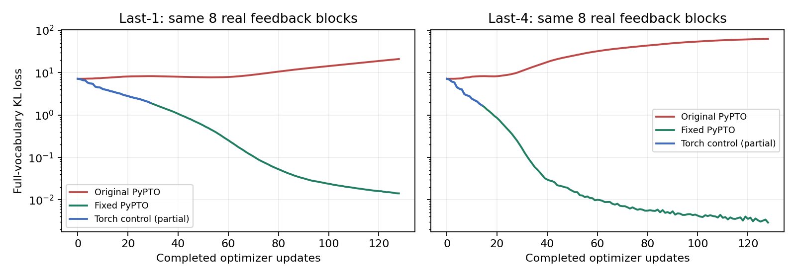

# 真实尺寸反向诊断与修复验证

验证对象是 Qwen3.8-27B 的 PyPTO 显式反向：相同 8 个真实反馈块、相同 FP32 初始参数、相同冻结权重和教师。有效 K=8，每次更新监督 56 个位置，底层使用 K32 缓冲。模型主参数、AR 历史和训练目标不变。



红线为故障实现，绿线为修复后 NPU 训练；蓝线为独立 Torch autograd 控制组实际完成的部分步数。loss 按更新前状态作图，完整 NPU 运行另含第 128 步更新后的重算值。固定批次拟合不等于留出集接受率或吞吐收益。

## 证据

| 内容 | last-1 | last-4 |
| --- | --- | --- |
| 故障版本，128 步 | [real-last1-r2.json](real-last1-r2.json) | [real-last4-r3.json](real-last4-r3.json) |
| 原版独立 Torch 对照 | [reference-last1-r1.json](reference-last1-r1.json) | [reference-last4-r1.json](reference-last4-r1.json) |
| 修复后生产 learner，128 步 | [fit-fixed-last1-r1.json](fit-fixed-last1-r1.json) | [fit-fixed-last4-r1.json](fit-fixed-last4-r1.json) |
| 修复后完整梯度、八块累积、同梯度 Adam 对照 | [reference-fixed-last1-r1.json](reference-fixed-last1-r1.json) | [reference-fixed-last4-r1.json](reference-fixed-last4-r1.json) |

旧版 Torch 控制组在发现明确梯度偏差后主动中止，实际完成 30 / 15 步；原始报告保留 `KeyboardInterrupt`，不算作完整训练验收。停止原因另存于 `.stop.json`。修复后的两个参考任务均正常结束、`passed=true`；各自执行独立 autograd、一次 Adam 及最终 NPU master 的前向复核。两个 NPU learner 各执行完整 128 步。

单卡反馈重放使用真实生产融合训练程序和 Adam，但发布对象仅是学习卡上的执行 bank。跨设备发布、新 head 的下一轮起草、HTTP 和恢复检查应查看完整模型的专门记录，不能从这里推断。

完整模型复验均正常退出：

- [last-1 真实反馈 KL 更新](serving-fixed-last1-r1.json)：16 次更新、12 个留出请求的逐 token AR 对照，三次同批 loss 重算均下降，最终 KV 与队列占用归零、请求零错误；checkpoint 正常保存。
- [last-4 K32 TV 在线闭环](online-tv-fixed-last4-r1.json)：两块反馈联合更新、新版本影响下一轮 logits、主模型历史不变、greedy 对齐；scheduler 发布版本 3，重建优化器恢复 checkpoint 后，HTTP 请求继续更新到版本 4。

以上证明修复后训练与推理协作正常。last-1 的三条 test 上接受候选数仅从 `1.00` 变为 `1.03` / 轮，固定 head 吞吐为 AR 的 `0.71×`，未实现净加速。

[summary.json](summary.json) 汇总实际数值。首块 6 / 33 组参数及八块累计梯度均通过预设相对 L2 `<6%`、余弦 `>0.99` 的判据；同梯度 Adam 的三类状态通过，执行参数按 master 转换后逐值一致。

## 故障定位

- [逐节点相同输入对照](stages-last1-local-r1.json)：第一处错误是 `dLogits @ lm_head`，形状 `[32,248320] @ [248320,5120]`。
- [逐行检查](lm-row-check.json)：第一行正确，后续行错误；未监督输入行均为零，其输出却非零。
- [修复后真实尺寸回归](lm-fixed-r2.json)：实际梯度、单行、词表最后一列三项均通过，无效行输出严格为零。
- [最终 CPU 回归](cpu-final.txt)：513 项通过，包含非 K32 缓冲前置拒绝；`cpu-fixed.txt` 为 512 项，`cpu.txt` 为诊断框架最初的 506 项记录。

修复把长行梯度按连续片段重排、转置，然后使用原有矩阵乘。并未改变损失、归一化或训练算法。核实现见 `training_long_linear.py`，实际选择入口为 `training_programs.py::make_linear`。

正式路径使用 32 行物理缓冲。额外 64 行实验未通过编译/运行，因此没有作为支持能力交付；入口拒绝非 32 行，新增 CPU 检查保证拒绝发生在导入设备运行时之前。有效块长不超过 32 的现有配置保持不变。

## 重放

在固定 OneServing / PyPTO 环境采集真实反馈后，可释放完整模型，单卡复现生产 learner：

```bash
PYTHONPATH=src python scripts/diagnose_qwen38_pypto_training.py \
  --phase fit --device 0 \
  --capture-report /results/real-last4.tensors/manifest.json \
  --steps 128 --learning-rate 1e-5 --output /results/fixed-last4.json

PYTHONPATH=src python scripts/diagnose_qwen38_pypto_training.py \
  --phase reference --capture-report /results/fixed-last4.tensors/manifest.json \
  --steps 1 --threads 16 --output /results/reference-fixed-last4.json
```

完整采集命令与固定环境见[诊断说明](../../../QWEN38_PYPTO_TRAINING_DIAGNOSIS.md)。真实输入、大权重、逐节点 tensor 和 Adam 检查点留在服务器；这里只提交 JSON、曲线和代码。各 `.supervisor.json` 保存实机命令、设备与退出码。

[最终资源检查](final-resource-check.json)确认 167 与 61 均无本轮实验 NPU 进程；其他用户的任务保持运行。
